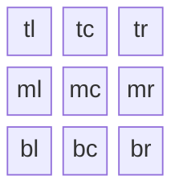
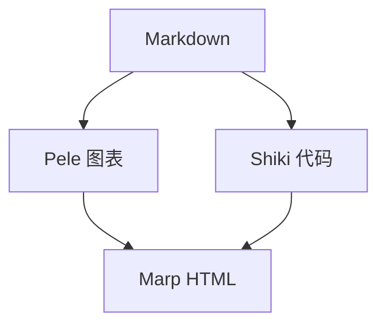
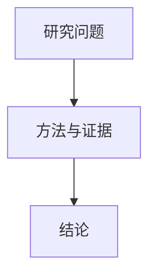

<!--
_class: cover
_paginate: skip
_header: ""
_footer: ""
-->

# Cinderfolio-Marp <small>用 Markdown 组织清晰的学术演示</small>

ShiJin

Cinderfolio

2026 年 10 月

<!-- 本演示也是主题用法示例。封面使用 cover，h1 自身居中，可选副标题写在标题内的 small 中；布局只需主题 CSS，作者、单位和日期均可省略。 -->

---

<!-- _class: transition -->

01

## 快速开始

选择构建方式，获得第一份演示。

<!-- 完整效果使用本项目的 CLI 引擎与资源。VS Code 扩展提供另一种编辑预览入口，但并不自动加载本项目的渲染扩展。 -->

---

## CLI · 完整体验

使用 Node.js **22.12+**，获取仓库中的独立 `cinderfolio/` 项目：

```sh
git clone --depth 1 https://github.com/sj-shijin/hp-rspress.git
cd hp-rspress/cinderfolio
npm ci
npm run build
npm run marp
```

编辑 `examples/marp.md` 后，重新运行 `npm run marp`。

打开 `dist/marp/example.html`；分享时复制整个 `dist/marp/`。

<!-- npm ci 使用独立锁文件安装 Marp CLI、Pele、Shiki。构建脚本加载 marp-engine.mjs，复制本地字体和图片，同时生成 example.html 与 example-4-3.html。这里复现默认配色、字体和渲染；网页调色器及同源状态同步由网站另外接入。资源中包含各自许可证。CLI 扩展入口：https://github.com/marp-team/marp-cli#engine -->

---

## VS Code · 编辑与预览

安装 [Marp for VS Code](https://github.com/marp-team/marp-vscode)，以 `cinderfolio/` 为工作区。
先生成主题，再写入 `.vscode/settings.json`：

```json
{
  "markdown.marp.themes": ["./dist/cf-marp.css"]
}
```

- 扩展可加载主题 CSS，预览封面、分栏、公式等内容。
- 本地字体、Pele、Shiki、标注块与行内标记还需额外接入。
- 要获得完整效果，在集成终端运行 `npm run marp`，打开生成的 HTML。

<!-- 已核对 Marp for VS Code 3.6.1 的公开配置和源码：主题 CSS 是正式入口，未提供自定义 engine 设置；预览直接创建 Marp，导出使用扩展生成的配置，不能把本站 marp-engine.mjs 直接填入扩展设置。可继续探索先用 Pele / Shiki 预渲染资源，或编写专用扩展；本演示未宣称这些方案已经接入。封面使用 Marp 原生支持的 h1 / small，不需要自定义引擎；完整字体需要 fonts/marp/font.css 及 WOFF2。来源：https://github.com/marp-team/marp-vscode#use-custom-theme-css 及 src/extension.ts、src/option.ts。 -->

---

<!-- header: '[快速开始](#2) **[特性展示](#5)** [标准 Markdown](#10) [扩展 Markdown](#14) [原生 Marp](#21)' -->
<!-- _class: transition -->

02

## 特性展示

封面、章节过渡与可组合的内容布局。

<!-- 这一页本身就是 transition 示例：编号、章节名和一句引导。标题与品牌线保持固定，删除可选文字不改变位置。 -->

---

## 封面与过渡页

<div class="cf-cols">

<div class="cf-col">

### 封面 `cover`

```markdown
<!-- _class: cover -->
# 报告标题 <small>副标题</small>
作者

单位

日期
```

标题支持一至两行；副标题、信息项均可省略。

</div>
<div class="cf-col">

### 过渡页 `transition`

```markdown
<!-- _class: transition -->
02
## 章节名
章节引导句
```

编号、引导句均可省略。

</div>
</div>

<!-- 第 1 页展示真实封面，五个章节入口展示真实过渡页。封面与过渡页品牌线距顶部 400px；封面 h1 自身居中于上部。可用 <br> 手动换行。封面清空页眉页脚、跳过编号的完整写法见本文件第一页。 -->

---

<!-- _class: compact -->

## 紧凑正文

<div class="cf-cols">

<div class="cf-col">

### 单页配置

```markdown
<!-- _class: compact -->

## 页标题

正文内容。
```

仅当前页生效，后页恢复常规。

</div>
<div class="cf-col">

### 正文字号与行距

| 配置 | 常规 | 紧凑 |
| :--- | :--- | :--- |
| 16:9 | 32px | 28px |
| 4:3 | 28px | 24px |
| 行高 | 1.5 | 1.4 |

</div>
</div>

<!-- 本页本身使用 compact，下一页自动恢复常规。紧凑布局仅调整正文，标题、品牌线与正文起点保持不动，图像高度仍由作者选择。 -->

---

<!-- _class: compact -->

## 自定义多栏布局

<div class="cf-col cf-align-tc">

用 `cf-cols` 分组、`cf-col` 分栏，分别选择列宽与对齐。

</div>

<div class="cf-cols">

<div class="cf-col cf-w3 cf-align-tl">

### 列宽权重 · 3:2

```html
<div class="cf-cols">
  <div class="cf-col cf-w3 cf-align-tl">
    <p>左栏</p>
  </div>
  <div class="cf-col cf-w2 cf-align-mc">
    <p>右栏</p>
  </div>
</div>
```

`cf-w1`—`cf-w5` 按权重分配宽度，可继续添加栏。

</div>
<div class="cf-col cf-w2 cf-align-mc">

### 九宫格对齐



`cf-align-*` 对应图中位置；本栏使用 `cf-align-mc`。

</div>
</div>

<div class="cf-col cf-align-tr">

默认等宽、左上对齐；空列收起，剩余一列占满宽度。

</div>

<!-- cf-cols 可放多个 cf-col；本页两列扣除间距后按 3:2 分配，左栏左上对齐、右栏整体居中。Mermaid block-beta 由 Pele 渲染九宫格：t/m/b 表示上中下，l/c/r 表示左中右，对应 cf-align-*。cf-col 独立使用就是全宽组，本页上方居中、下方靠右；HTML 容器内写 Markdown 时，标签与内容之间保留空行。垂直对齐在另一栏更高或组有额外高度时才有可分配空间；任意权重或额外高度可用 style scoped 设置 flex-grow 或 min-height。 -->

---

## Pele 图表与 Shiki 代码

<div class="cf-cols">

<div class="cf-col">

### Shiki · 阅读流程

```ts
// 先准备内容，再生成演示。
function slideTitle(title: string) {
  if (!title.trim()) return 'Cinderfolio';
  return title.trim();
}
```

普通代码围栏指定语言，复用 Cinderfolio 的亮暗主题。

</div>
<div class="cf-col cf-align-tc">

### Pele · 构建期绘图



`mermaid` 围栏生成内联 SVG，颜色跟随演示主题。

</div>
</div>

<!-- Pele 与 Shiki 属于 Cinderfolio 的 CLI 扩展，不是 Marp 原生功能。多图以 Markdown 行号生成独立 SVG ID；浏览器只接收生成结果，不重复加载渲染器。调色继续复用同一组 CSS 变量。 -->

---

<!-- header: '[快速开始](#2) [特性展示](#5) **[标准 Markdown](#10)** [扩展 Markdown](#14) [原生 Marp](#21)' -->
<!-- _class: transition -->

03

## 标准 Markdown

用标题、列表、引用与链接组织内容。

<!-- 本章以 CommonMark 核心语法为准；Marp 对分页与列表标记的特殊处理放在原生 Marp 章。参考：https://spec.commonmark.org/ -->

---

<!-- _class: compact -->

## 文字与代码

<div class="cf-cols">

<div class="cf-col">

### 写法

````markdown
### 页内标题
*斜体* **粗体** ***粗斜体***
`行内代码`
\*原样星号\*

```python
print("Cinderfolio")
```
````

</div>
<div class="cf-col">

### 页内标题

*斜体*　**粗体**　***粗斜体***

`行内代码`

\*原样星号\*

```python
print("Cinderfolio")
```

</div>
</div>

用空行分段；行末两个空格可手动换行。

<!-- 标题、强调、行内代码、代码围栏与反斜杠转义属于 CommonMark 核心语法。代码围栏本身是核心语法，语法高亮由本站 Shiki 引擎提供。Marp 还会把普通段落内的换行转换为 br；本主题约定封面 h1、页题 h2、页内标题 h3 起，原生 Markdown 支持 h1–h6。独立横线会被 Marp 用于分页，见原生 Marp 章。 -->

---

<!-- _class: compact -->

## 列表与引用

<div class="cf-cols">

<div class="cf-col">

### 写法

```markdown
- 研究问题
  - 数据与约束

1. 建模
2. 验证

> 先给结论，再展示证据。
```

</div>
<div class="cf-col">

### 效果

- 研究问题
  - 数据与约束

1. 建模
2. 验证

> 先给结论，再展示证据。

</div>
</div>

`-`、`+` 与 `1.` 直接显示；`*`、`1)` 在 Marp 中用于分步。

<!-- 无序列表、有序列表、嵌套列表与引用均为核心语法。CommonMark 的 *、-、+ 都可创建无序列表，1. 和 1) 都可创建有序列表；Marp 为 * 和 1) 增加了分步行为，这里使用 - 与 1. 避免把核心语法演示隐藏起来。 -->

---

<!-- _class: compact -->

## 链接与图片

<div class="cf-cols">

<div class="cf-col">

### 写法

```markdown
[Marp 官网](https://marp.app/)


```

链接使用 `[文字](地址)`，图片在前面加 `!`。

图片说明用作替代文本；尺寸设置见“原生 Marp”。

</div>
<div class="cf-col">

### 效果

[Marp 官网](https://marp.app/)


</div>
</div>

<!-- 本页图片使用纯 Markdown 图片语法，没有 w/h/bg 等 Marp 扩展；宽度仅受主题的横向防溢出限制。图片使用现有获准资源，来源与许可见 assets/SOURCE.json。链接与图片也可使用引用式定义，参考：https://spec.commonmark.org/ -->

---

<!-- header: '[快速开始](#2) [特性展示](#5) [标准 Markdown](#10) **[扩展 Markdown](#14)** [原生 Marp](#21)' -->
<!-- _class: transition -->

04

## 扩展 Markdown

用表格、公式与图表补充结构化表达。

<!-- 扩展 Markdown 不是单一标准。当前 Marp Core 4.4.0 支持 GFM 表格、删除线与数学公式；Mermaid 由 Pele 引擎提供，标注块、高亮与上下标由 Cinderfolio 的 Markdown 扩展提供。任务列表和脚注尚未启用，只列写法。参考：https://github.com/marp-team/marp-core/tree/v4#marp-markdown -->

---

<!-- _class: compact -->

## 表格与行内标记

<div class="cf-cols">

<div class="cf-col">

### 写法

```markdown
| 方法 | 延迟 | 得分 |
| :--- | :---: | ---: |
| 基线 | 12 ms | 80 |
| 改进 | 8 ms | 92 |

~~旧结论~~ 更新后的结论。

==高亮== 重点信息。

x^2^ 与 H~2~O
```

</div>
<div class="cf-col">

### 效果

| 方法 | 延迟 | 得分 |
| :--- | :---: | ---: |
| 基线 | 12 ms | 80 |
| 改进 | 8 ms | 92 |

~~旧结论~~ 更新后的结论。

==高亮== 重点信息。

x^2^ 与 H~2~O

</div>
</div>

冒号控制列对齐；`==` 高亮，`^` 上标，`~` 下标，`~~` 删除线。

<!-- 表格与删除线属于 GFM 扩展，Marp Core 默认启用；高亮与上下标由 markdown-it-mark / sup / sub 提供，分别生成 mark / sup / sub。高亮使用现有文字选区的淡品牌色，保留正文文字色；上下标沿用原生排版，复杂表达式仍使用数学公式。表中数字仅用于展示对齐。参考：https://github.github.com/gfm/#tables-extension- 、https://github.com/markdown-it/markdown-it-mark 、https://github.com/markdown-it/markdown-it-sup 和 https://github.com/markdown-it/markdown-it-sub -->

---

<!-- _class: compact -->

## 数学公式

<div class="cf-cols">

<div class="cf-col">

### 写法

```tex
行内公式：$E = mc^2$

$$
\sum_{i=1}^{n} i
= \frac{n(n+1)}{2}
$$
```

</div>
<div class="cf-col">

### 效果

行内公式：$E = mc^2$

$$
\sum_{i=1}^{n} i = \frac{n(n+1)}{2}
$$

</div>
</div>

`$…$` 用于行内，`$$…$$` 用于独立公式。

<!-- 数学语法属于 Markdown 扩展，Marp Core 内置支持。本例通过 math: mathjax 选择 MathJax，也可选择 katex；不在浏览器重复加载网站公式组件。参考：https://github.com/marp-team/marp-core/tree/v4#math-typesetting -->

---

<!-- _class: compact -->

## Mermaid 图表

<div class="cf-cols">

<div class="cf-col">

### 写法

````markdown

````

使用 `mermaid` 代码围栏。

</div>
<div class="cf-col cf-align-tc">

### Pele 渲染


</div>
</div>

图表由 Cinderfolio 的 Pele 扩展生成，配色跟随亮暗主题。

<!-- Mermaid 围栏复用 marp-engine.mjs 中已接入的 Pele，不属于当前 Marp Core 4.4.0 原生图表能力。与前面的 Cinderfolio 渲染流程示例使用不同图表，验证多图 ID 与引用不会冲突。 -->

---

<!-- _class: compact -->

## 标注块 · 一句话结论

```markdown
> [!IMPORTANT]
> **核心结论：** 分层处理减少了重复计算。
```

> [!IMPORTANT]
> **核心结论：** 分层处理减少了重复计算。

<div class="cf-cols">

<div class="cf-col">

### 补充说明 · 写法

```markdown
> [!NOTE]
> 结果基于相同数据与硬件。
```

</div>
<div class="cf-col">

### 栏内效果

> [!NOTE]
> 结果基于相同数据与硬件。

</div>
</div>

<!-- IMPORTANT 采用 2px 品牌色边框和现有淡品牌色底，默认省略重复标题；NOTE 使用灰阶边界与浅层底色。正文、粗体与斜体继承所在段落的文字颜色。标注块可用于整页结论，也可直接放入 cf-col；解析由 Cinderfolio 的引擎扩展提供，样式随 cf-marp.css 导出。 -->

---

<!-- _class: compact -->

## 标注块 · 提示与提醒

<div class="cf-cols">

<div class="cf-col">

### 写法

```markdown
> [!TIP]
> 先讲结论，再展示证据。

> [!WARNING]
> 留意方法的适用范围。

> [!CAUTION]
> 不将相关性当作因果。
```

</div>
<div class="cf-col">

### 效果

> [!TIP]
> 先讲结论，再展示证据。

> [!WARNING]
> 留意方法的适用范围。

> [!CAUTION]
> 不将相关性当作因果。

</div>
</div>

<!-- 五种标记共用现有品牌色与灰阶，通过标题及边框区分职责；不引入额外红黄绿配色。普通 > 仍是引用。标记采用 GitHub 风格，Markdown 标注块由引擎在构建期转换为 HTML，不需要额外浏览器脚本。参考：https://docs.github.com/en/get-started/writing-on-github/getting-started-with-writing-and-formatting-on-github/basic-writing-and-formatting-syntax#alerts -->

---

<!-- _class: compact -->

## 更多扩展语法

任务列表与脚注尚未启用，以下仅展示写法。

<div class="cf-cols">

<div class="cf-col">

### 任务列表

```markdown
- [x] 完成实验
- [ ] 整理结论
```

使用勾选状态记录待办事项。

</div>
<div class="cf-col">

### 脚注

```markdown
结论的补充说明[^note]。

[^note]: 数据与方法的来源。
```

脚注显示在正文中，不同于演讲备注。

</div>
</div>

<!-- 这两类扩展暂未接入，仅在代码围栏中介绍写法。当前 - [x] 保留为普通列表文字，[^note] 不会生成脚注。脚注扩展还需明确按页归属，而不是统一追加到文档末尾。来源：https://github.github.com/gfm/#task-list-items-extension- 及 https://github.com/markdown-it/markdown-it-footnote -->

---

<!-- header: '[快速开始](#2) [特性展示](#5) [标准 Markdown](#10) [扩展 Markdown](#14) **[原生 Marp](#21)**' -->
<!-- _class: transition -->

05

## 原生 Marp

用指令、图片语法与分步列表组织演示。

<!-- 本章介绍 Marp 原生的文档与单页指令、翻页转场、scoped 样式、图片尺寸与背景，以及分步列表和演讲备注。cover / compact / transition 的类名属于 Cinderfolio 主题，承载它们的 class 指令属于 Marp；transition 转场指令则控制翻页动画。参考：https://marpit.marp.app/markdown -->

---

<!-- _class: compact -->

## 文档设置

<div class="cf-cols">

<div class="cf-col">

### 文档开头

```yaml
---
marp: true
theme: cinderfolio
size: 16:9
paginate: true
transition: fade 300ms
math: mathjax
header: 研究汇报
footer: 作者 · 单位
---
```

页眉、页脚与页码统一设置。
[fade 300ms：全篇淡入淡出](https://github.com/marp-team/marp-cli/blob/main/docs/bespoke-transitions/README.md)。

</div>
<div class="cf-col">

### 章节首页更新

```markdown
<!--
header: >
  [快速开始](#2)
  [特性展示](#5)
  [标准 Markdown](#10)
  [扩展 Markdown](#14)
  **[原生 Marp](#21)**
footer: Cinderfolio · 作者
-->
```

修改后延续到后页；用 **加粗** 标记当前章节。

`#n` 指向实际第 n 页，与页脚编号无关。

</div>
</div>

<!-- theme / size 是全局指令。header / footer / paginate 是可继承的局部指令，放在文档开头作为全篇默认值，后续章节可再次更新；加下划线则只覆盖当前页。transition: fade 300ms 为整份 HTML 演示设置 300 毫秒淡入淡出，作用于当前页到下一页的边界；_transition: none 可单独关闭一处，PDF 不保留动画。转场由 CLI 的 bespoke 播放器提供，不影响 Cinderfolio 的 transition 章节页排版。header 支持 Markdown 链接，当前章节的加粗标记由 Cinderfolio 主题显示为选中的分块。链接使用实际幻灯片序号，封面跳过编号不会改变链接目标。size 可改为 4:3；独立一行的 --- 分页。参考：https://marpit.marp.app/directives 及 https://github.com/marp-team/marp-cli/blob/main/docs/bespoke-transitions/README.md -->

---

<!-- _class: compact -->

## 单页设置

<div class="cf-cols">

<div class="cf-col">

### 完整封面配置

```markdown
<!--
_class: cover
_header: ""
_footer: ""
_paginate: skip
-->
# 报告标题 <small>副标题</small>
作者

单位

日期
```

</div>
<div class="cf-col">

### 仅覆盖当前页

- `_class: cover` 使用封面预设。
- `_header: ""` 清空页眉。
- `_footer: ""` 清空页脚。

### 页码处理

- `_paginate: skip` 隐藏且不计数。
- `_paginate: false` 隐藏但仍计数。

带 `_` 的设置仅本页有效，后页自动恢复。

</div>
</div>

<!-- 左侧为可复制的封面配置：作者、单位、日期保留为独立段落，副标题与信息项均可省略。文档已设置 paginate: true 时，封面使用 skip 后，下一张正文从 1 开始；false 只隐藏编号，仍消耗一个页码。class 是 Marp 原生指令，cover 是 Cinderfolio 提供的预设。参考：https://marpit.marp.app/directives -->

---

<!-- _class: compact -->

## 局部样式 · 代码与图表

将 `<style scoped>` 写在需要调整的页内，仅当前页生效。

<div class="cf-cols">

<div class="cf-col">

### 代码块字号

````markdown
<style scoped>
pre code {
  font-size: 24px;
}
</style>

```python
print("Cinderfolio")
```
````

</div>
<div class="cf-col">

### Mermaid 图表大小

````markdown
<style scoped>
figure.cinderfolio-pele > svg {
  width: 320px;
  height: auto;
}
</style>


````

</div>
</div>

<!-- scoped 是 Marp 原生的单页样式。左例调整当前页代码字号，保留原生横向缩放；右例针对 Pele 生成的 Mermaid SVG 设置宽度，height: auto 保持原始比例，max-width: 100% 继续防止横向溢出。两段示例也可合并到同一个 style scoped 中。 -->

---

## 图片 · 尺寸与图注

<div class="cf-cols">

<div class="cf-col cf-align-tc">

<figure>


<figcaption>固定高度：<code></code></figcaption>

</figure>

</div>
<div class="cf-col cf-align-tc">

<figure>


<figcaption>固定宽度：<code></code></figcaption>

</figure>

</div>
</div>

`figure` 与 `figcaption` 是原生 HTML；不需要图注时可直接放图片。

背景图用 ``；`fit` 完整显示，`cover` 填满。

<!-- 图片按原始比例缩放，主题只限制最大宽度，不设置全局高度上限；作者需控制一页内图片的合计高度。两个示例照片的作者、许可和来源见 assets/SOURCE.json。参考：https://marpit.marp.app/image-syntax -->

---

<!-- _class: compact -->

## 分步展示与演讲备注

<div class="cf-cols">

<div class="cf-col">

### 无序分步 · `*`

```markdown
* 提出研究问题
* 展示方法与证据
```

* 提出研究问题
* 展示方法与证据

</div>
<div class="cf-col">

### 有序分步 · `1)`

```markdown
1) 归纳结论
2) 说明局限
```

1) 归纳结论
2) 说明局限

</div>
</div>

`→` / 空格前进，`←` 返回；`-`、`+`、`1.` 直接全部显示。

普通 `<!-- 注释 -->` 作为演讲备注，不显示在正文。

<!-- 这是本页实际备注：先逐项显示左栏，再逐项显示右栏；右栏使用英文半角右括号 1)，不是全角 1）。cf-col 内的列表保留分步行为，整栏当前没有独立分步标记。分步交互需要播放器，静态 PDF 展示全部内容；普通注释成为演讲备注，Marp 指令注释由配置系统处理。独立横线 --- 用于分页，而不是在正文中显示 hr。参考：https://marpit.marp.app/fragmented-list 和 https://marpit.marp.app/usage?id=presenter-notes -->
