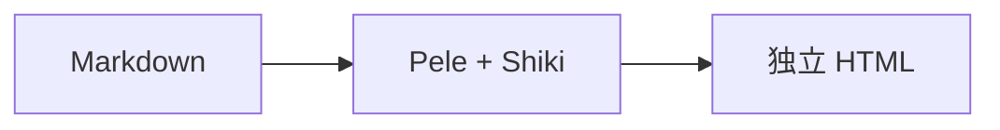
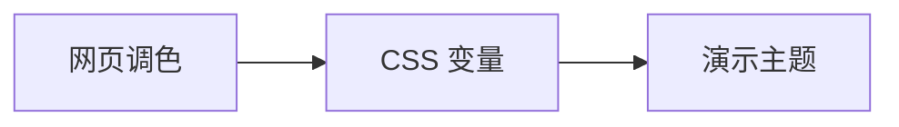

# Cinderfolio **Marp**

同一套配色，从网页到演示。

Cinderfolio · Clear ideas, consistent slides.

*深色 · 浅色 · 品牌色*

<!-- 这是公开的示例备注。介绍三个颜色种子，再翻到下一页。 -->

---

## 内容与层次

- **重点**：让视线先找到主题。
- 正文：使用深浅端点，保持清晰。
- *说明*：沿用固定灰阶，减少干扰。

> 引用与分组复用浅层底色，品牌色只作少量强调。

| 内容 | 方式 |
| --- | --- |
| 图表 | Pele SVG |
| 代码 | Shiki 主题 |

<!-- 正文、强调、说明、引用与表格复用同一套配色。 -->

---

## 从 Markdown 到演示





<!-- 两张图复用 A、B、C 节点名；真正的 SVG ID 与可访问性引用各自独立。 -->

---

## 代码与阅读层级

```ts
type Slide = { title: string; ready: boolean };

// 先看流程，再读细节。
function presentReady(slides: Slide[]) {
  for (const slide of slides) {
    if (slide.ready) present(slide.title);
  }
}
```

<!-- 代码复用 Cinderfolio-Shiki：品牌色导航、端点粗体主体、斜体注释与灰色辅助信息。 -->
