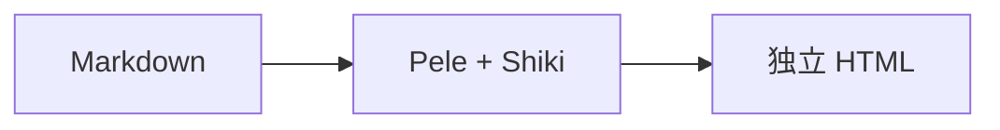
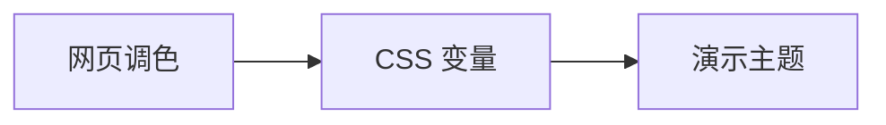

# 标题层级 · Heading 1

## 二级标题 · Heading 2

### 三级标题 · Heading 3

清晰的层级，让视线从标题自然进入正文。
Clear hierarchy makes content easier to scan.

<!-- h1 固定为页题；正文展示 h2、h3、p、br。各页共用底部的 header、footer 与页码。 -->

---

# 次级标题

#### 四级标题 · Heading 4

##### 五级标题 · Heading 5

###### 六级标题 · Heading 6

小标题保留各自的字号、字重与上下间距。

<!-- h4、h5、h6；不添加局部样式，直接观察主题中的标题层级。 -->

---

# 正文与行内元素

用一段中英混排观察字形、行距与自动换行。Cinderfolio connects clear ideas with consistent typography，让中文、English 和数字 0123456789 保持自然的阅读节奏。

**粗体强调 Strong**　*斜体说明 Emphasis*　***粗斜体***

~~删除的内容~~　`inline code`　[链接 Link](https://marp.app/)

同一段中的第一行。
换行后继续阅读；空行则开始新的段落。

<!-- p、br、strong、em、s、code、a；相同 HTML 结构只保留一组代表内容。 -->

---

# 列表与引用

- 明确主题
  1. 收集依据
  2. 组织内容
- 呈现结论

> 用一句话突出主要观点。
>
> > 补充说明，形成第二层引用。

<!-- ul、ol、li、blockquote、p；同时观察标记、缩进与嵌套间距。 -->

---

# 表格

| 内容 · 左对齐 | 状态 · 居中 | 数量 · 右对齐 |
| :--- | :---: | ---: |
| 普通正文 | 待整理 | 12 |
| **重点内容** | 已确认 | 128 |
| `inline code` | 可复用 | 1,024 |
| [参考链接](https://marp.app/) | 已归档 | 8,192 |

表头、隔行底色、单元格留白与数字对齐。

<!-- table、thead、tbody、tr、th、td；包含普通文字与行内格式。 -->

---

# 图片

 [](https://marp.app/)

山脉与湖泊　·　工作台与设备

<!-- p > img 与 a > img；照片本地托管，来源与作者见 assets/SOURCE.json。 -->

---

# 公式

行内公式 $E = mc^2$，以及复杂度 $O(n\log n)$。

$$
\sum_{i=1}^{n} i = \frac{n(n+1)}{2}, \qquad
A = \begin{bmatrix}1 & 2\\3 & 4\end{bmatrix}
$$

$$
f(x)=\begin{cases}
x^2, & x\geq0,\\
-x, & x<0.
\end{cases}
$$

<!-- MathJax 的行内与块级 mjx-container / SVG；保留原生数学字形。 -->

---

# 代码

    输入 Markdown
    输出 HTML

```ts
// 先看流程，再读细节。
function presentReady(slides: { title: string; ready: boolean }[]) {
  for (const slide of slides) {
    if (slide.ready) present(slide.title);
  }
}
```

<!-- 原生 pre > code 与 Shiki 的 pre > code > span；比较纯文本、缩进与高亮。 -->

---

# 图表





<!-- figure > svg；保留双图，观察中文、英文、节点、连线和图间距。 -->
