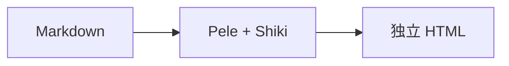

<!--
_class: cover
_paginate: skip
_header: ""
_footer: ""
-->

# Cinderfolio 学术汇报

## 从研究问题到清晰结论

ShiJin

示例研究组

2026 年 10 月 24 日

<!-- 封面与过渡页的品牌线均距顶部 400px；cover 的 h1 自身在上方居中，h2 跟随主标题且不参与定位；信息段落在下方整体居中，任意项可省略，封面不计页码。 -->

---

# 标题层级 · Heading 1

## 二级标题 · Heading 2

### 三级标题 · Heading 3

清晰的层级，让视线从标题自然进入正文。
Clear hierarchy makes content easier to scan.

<!-- h1 固定为页题；正文展示 h2、h3、p、br。顶部用原生 header 列出章节，底部共用 footer 与页码。 -->

---

# 次级标题

#### 四级标题 · Heading 4

##### 五级标题 · Heading 5

###### 六级标题 · Heading 6

小标题保留各自的字号、字重与上下间距。

<!-- h4、h5、h6；不添加局部样式，直接观察主题中的标题层级。 -->

---

<!-- header: '[标题](#2) **[正文](#4)** [数据](#7) [代码](#10) [图表](#11)' -->
<!-- _class: transition -->

02

# 正文表达

如何让文字与图像共同说明一个观点？

<!-- 过渡页品牌线距顶部 400px；编号与引导句均可省略，删除后不移动标题和品牌线。沿用章节导航与页脚。 -->

---

# 正文与行内元素

<div class="cf-col cf-align-tc">

文字说明重点，图片提供依据；最后用一句话归纳结论。

</div>

<div class="cf-cols">

<div class="cf-col cf-w3 cf-align-ml">

**粗体 Strong** 与 *斜体 Emphasis*

***粗斜体***、~~删除内容~~

`inline code`、数字 0123456789

[链接 Link](https://marp.app/) 连接参考资料。

</div>
<div class="cf-col cf-w2 cf-align-tc">

<figure>


<figcaption>工作台与设备 · Aleks Dorohovich</figcaption>

</figure>

</div>
</div>

<div class="cf-col cf-align-tr">

**结论：** 让每一张图都对应一个可以解释的观点。

</div>

<!-- 上方单栏居中、下方单栏靠右；中间 3:2 双栏，左栏文字靠左、整组垂直居中，右栏图片居中、顶部对齐。图片自行指定宽度，主题不再固定限高。空组收起，剩余列自动铺满。 -->

---

# 列表与引用

- 明确主题
  1. 收集依据
  2. 组织内容
- 呈现结论

> 用一句话突出主要观点。
>
> > 补充说明，形成第二层引用。

<!-- ul、ol、li、blockquote、p；同时观察标记、缩进与嵌套间距。 -->

---

<!-- header: '[标题](#2) [正文](#4) **[数据](#7)** [代码](#10) [图表](#11)' -->

# 表格

| 内容 · 左对齐 | 状态 · 居中 | 数量 · 右对齐 |
| :--- | :---: | ---: |
| 普通正文 | 待整理 | 12 |
| **重点内容** | 已确认 | 128 |
| `inline code` | 可复用 | 1,024 |
| [参考链接](https://marp.app/) | 已归档 | 8,192 |

表头、隔行底色、单元格留白与数字对齐。

<!-- table、thead、tbody、tr、th、td；包含普通文字与行内格式。 -->

---

# 图片

<div class="cf-col cf-align-tc">

[](https://marp.app/)

</div>

<!-- 单张图片使用整页正文区域；h:500 是本页选定的尺寸，不是主题上限。保留 p > a > img，照片来源与作者见 assets/SOURCE.json。 -->

---

# 公式

行内公式 $E = mc^2$，以及复杂度 $O(n\log n)$。

$$
\sum_{i=1}^{n} i = \frac{n(n+1)}{2}, \qquad
A = \begin{bmatrix}1 & 2\\3 & 4\end{bmatrix}
$$

$$
f(x)=\begin{cases}
x^2, & x\geq0,\\
-x, & x<0.
\end{cases}
$$

<!-- MathJax 的行内与块级 mjx-container / SVG；保留原生数学字形。 -->

---

<!-- header: '[标题](#2) [正文](#4) [数据](#7) **[代码](#10)** [图表](#11)' -->

# 代码

    输入 Markdown
    输出 HTML

```ts
// 先看流程，再读细节。
function presentReady(slides: { title: string; ready: boolean }[]) {
  for (const slide of slides) {
    if (slide.ready) present(slide.title);
  }
}
```

<!-- 原生 pre > code 与 Shiki 的 pre > code > span；比较纯文本、缩进与高亮。 -->

---

<!-- header: '[标题](#2) [正文](#4) [数据](#7) [代码](#10) **[图表](#11)**' -->

# 图表




<!-- figure > svg；保留双图，观察中文、英文、节点、连线和图间距。 -->
