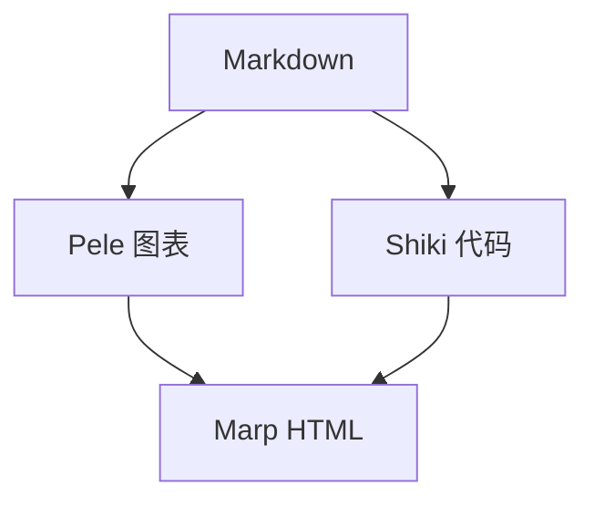

<!--
_class: cover
_paginate: skip
_header: ""
_footer: ""
-->

# Cinderfolio-Marp

###### 用 Markdown 组织清晰的学术演示

ShiJin

Cinderfolio

2026 年 10 月

<!-- 本演示也是主题用法示例。封面使用 cover，标题和副标题由 Cinderfolio 引擎自动分组；作者、单位和日期均可省略。 -->

---

<!-- _class: transition -->

01

## 快速开始

选择构建方式，获得第一份演示。

<!-- 完整效果使用本项目的 CLI 引擎与资源。VS Code 扩展提供另一种编辑预览入口，但并不自动加载本项目的渲染扩展。 -->

---

## CLI · 完整体验

使用 Node.js **22.12+**，获取仓库中的独立 `cinderfolio/` 项目：

```sh
git clone --depth 1 https://github.com/sj-shijin/hp-rspress.git
cd hp-rspress/cinderfolio
npm ci
npm run build
npm run marp
```

编辑 `examples/marp.md` 后，重新运行 `npm run marp`。

打开 `dist/marp/example.html`；分享时复制整个 `dist/marp/`。

<!-- npm ci 使用独立锁文件安装 Marp CLI、Pele、Shiki。构建脚本加载 marp-engine.mjs，复制本地字体和图片，同时生成 example.html 与 example-4-3.html。这里复现默认配色、字体和渲染；网页调色器及同源状态同步由网站另外接入。资源中包含各自许可证。CLI 扩展入口：https://github.com/marp-team/marp-cli#engine -->

---

## VS Code · 编辑与预览

安装 [Marp for VS Code](https://github.com/marp-team/marp-vscode)，以 `cinderfolio/` 为工作区。
先生成主题，再写入 `.vscode/settings.json`：

```json
{
  "markdown.marp.themes": ["./dist/cf-marp.css"]
}
```

- 扩展可加载主题 CSS，预览分栏、公式等原生内容。
- 本地字体、Pele、Shiki 与封面自动分组还需额外接入。
- 要获得完整效果，在集成终端运行 `npm run marp`，打开生成的 HTML。

<!-- 已核对 Marp for VS Code 3.6.1 的公开配置和源码：主题 CSS 是正式入口，未提供自定义 engine 设置；预览直接创建 Marp，导出使用扩展生成的配置，不能把本站 marp-engine.mjs 直接填入扩展设置。可继续探索先用 Pele / Shiki 预渲染资源，或编写专用扩展；本演示未宣称这些方案已经接入。仅加载主题 CSS 时，封面可手动使用 div.cf-marp-cover-title 包住 h1/h6；完整字体需要 fonts/marp/font.css 及 WOFF2。来源：https://github.com/marp-team/marp-vscode#use-custom-theme-css 及 src/extension.ts、src/option.ts。 -->

---

<!-- header: '[快速开始](#2) **[特性展示](#5)** [高级 Marp](#12)' -->
<!-- _class: transition -->

02

## 特性展示

封面、章节过渡与可组合的内容布局。

<!-- 这一页本身就是 transition 示例：编号、章节名和一句引导。标题与品牌线保持固定，删除可选文字不改变位置。 -->

---

## 封面与过渡页

<div class="cf-cols">

<div class="cf-col">

### 封面 `cover`

```markdown
<!-- _class: cover -->

# 报告标题

###### 副标题

作者

单位

日期
```

标题支持一至两行；副标题、信息项均可省略。

</div>
<div class="cf-col">

### 过渡页 `transition`

```markdown
<!-- _class: transition -->

02

## 章节名

章节引导句
```

编号、引导句均可省略。

</div>
</div>

<!-- 第 1 页展示真实封面，第 2、5、12 页展示真实过渡页。封面与过渡页品牌线距顶部 400px；封面 h1 自身居中于上部。可用 <br> 手动换行。封面清空页眉页脚、跳过编号的完整写法见本文件第一页。 -->

---

## 正文页与紧凑正文页

<div class="cf-col">

**常规布局** · 标题区固定，正文按内容量选择密度。

</div>

<div class="cf-cols">

<div class="cf-col">

### 同一结构，两种密度

- 常规：保留舒展的行距。
- 紧凑：收紧字号与段间距。
- 标题区与正文密度独立。

</div>
<div class="cf-col">

### 正文字号与行距

| 配置 | 常规 | 紧凑 |
| :--- | :--- | :--- |
| 16:9 | 32px | 28px |
| 4:3 | 28px | 24px |
| 行高 | 1.5 | 1.4 |

</div>
</div>

<div class="cf-col">

仅本页启用紧凑：`<!-- _class: compact -->`

</div>

<!-- 与下一页共用相同内容和结构；本页为默认常规布局，不需要 class。页题为 40px / 36px，三处间距均为 16px；正文边距为 64px / 48px。 -->

---

<!-- _class: compact -->

## 常规与紧凑正文

<div class="cf-col">

**紧凑布局** · 标题区固定，正文按内容量选择密度。

</div>

<div class="cf-cols">

<div class="cf-col">

### 同一结构，两种密度

- 常规：保留舒展的行距。
- 紧凑：收紧字号与段间距。
- 标题区与正文密度独立。

</div>
<div class="cf-col">

### 正文字号与行距

| 配置 | 常规 | 紧凑 |
| :--- | :--- | :--- |
| 16:9 | 32px | 28px |
| 4:3 | 28px | 24px |
| 行高 | 1.5 | 1.4 |

</div>
</div>

<div class="cf-col">

仅本页启用紧凑：`<!-- _class: compact -->`

</div>

<!-- _class 只作用于本页；下一页自动恢复常规。紧凑布局仅调整正文，标题、品牌线与正文起点与前一页一致，图像高度仍由作者选择。 -->

---

## 单栏—双栏—单栏

<div class="cf-col cf-align-tc">

先给出观点，中间用文字与图像展开，最后归纳结论。

</div>

<div class="cf-cols">

<div class="cf-col">

```html
<div class="cf-cols">
  <div class="cf-col">
    <p>左栏</p>
  </div>
  <div class="cf-col">
    <p>右栏</p>
  </div>
</div>
```

</div>
<div class="cf-col cf-align-tc">

<figure>


<figcaption>文字说明观点，图像提供上下文。</figcaption>

</figure>

</div>
</div>

<div class="cf-col cf-align-tr">

**默认等宽、顶部对齐；空列收起，剩余一列占满宽度。**

</div>

<!-- cf-col 独立使用就是全宽组，本页上方居中、下方靠右；HTML 容器内写 Markdown 时，标签与内容之间保留空行。图片来自 examples/assets/SOURCE.json；不是主题附带的研究数据。 -->

---

## 比例与九宫格对齐

<div class="cf-cols">

<div class="cf-col cf-w3 cf-align-ml">

### 宽度按权重分配

```html
<div class="cf-cols">
  <div class="cf-col cf-w3">
    <p>左栏</p>
  </div>
  <div class="cf-col cf-w2">
    <p>右栏</p>
  </div>
</div>
```

本页为 **3:2**。可用 `cf-w1`—`cf-w5`；不写时为 1。

</div>
<div class="cf-col cf-w2 cf-align-tc">

### `cf-align-*`

| 左 | 中 | 右 |
| :---: | :---: | :---: |
| `tl` | `tc` | `tr` |
| `ml` | `mc` | `mr` |
| `bl` | `bc` | `br` |

默认 `tl`；本栏使用 `tc`。

</div>
</div>

<!-- 本页左栏使用 cf-align-ml，整组垂直居中；右栏使用 cf-align-tc。两列宽度扣除间距后按 3:2 分配。需要额外高度或任意权重时，可用 Marp 的 style scoped 设置组 min-height 或列 flex-grow。 -->

---

## Pele 图表与 Shiki 代码

<div class="cf-cols">

<div class="cf-col">

### Shiki · 阅读流程

```ts
// 先准备内容，再生成演示。
function slideTitle(title: string) {
  if (!title.trim()) return 'Cinderfolio';
  return title.trim();
}
```

普通代码围栏指定语言，复用 Cinderfolio 的亮暗主题。

</div>
<div class="cf-col cf-align-tc">

### Pele · 构建期绘图



`mermaid` 围栏生成内联 SVG，颜色跟随演示主题。

</div>
</div>

<!-- Pele 与 Shiki 属于 Cinderfolio 的 CLI 扩展，不是 Marp 原生功能。多图以 Markdown 行号生成独立 SVG ID；浏览器只接收生成结果，不重复加载渲染器。调色继续复用同一组 CSS 变量。 -->

---

<!-- header: '[快速开始](#2) [特性展示](#5) **[高级 Marp](#12)**' -->
<!-- _class: transition -->

03

## 高级 Marp

用原生指令组织页面，用 Markdown 表达内容。

<!-- 以下展示 Marp 原生支持的指令、公式、表格、图片、分步列表和演讲备注；不再为每个 HTML 标签单独安排一页。 -->

---

## 原生指令 · 文档与单页

<div class="cf-cols">

<div class="cf-col">

### 文档开头

```yaml
---
marp: true
theme: cinderfolio
size: 16:9
paginate: true
math: mathjax
---
```

将 `size` 改为 `4:3`，即可切换画幅。

</div>
<div class="cf-col">

### 页面内

```markdown
<!-- header: 研究方法 -->
<!-- _footer: 仅本页的补充说明 -->

## 页标题

正文内容。
```

`header` 延续到后页；`_footer` 仅作用于当前页。

</div>
</div>

<!-- 用独立一行的 --- 分页。全局指令与可继承的局部指令含义不同：size / theme 属于文档配置，header / footer 可在分页后继续修改，加下划线则只覆盖当前页。参考：https://marpit.marp.app/directives -->

---

## 公式与表格

<div class="cf-cols">

<div class="cf-col">

### 数学表达

行内公式 `$E = mc^2$`：$E = mc^2$。

块级公式使用 `$$` 包裹：

$$
\sum_{i=1}^{n} i = \frac{n(n+1)}{2}
$$

</div>
<div class="cf-col">

### 结构化信息

| 主题能力 | 写法 |
| :--- | :--- |
| **封面** | `cover` |
| 章节过渡 | `transition` |
| 内容分栏 | `cf-cols` / `cf-col` |

表格使用 Markdown 管道语法，可分别指定列的对齐。

</div>
</div>

<!-- 本例通过 math: mathjax 使用 Marp Core 内置 MathJax；也可选择 katex。没有在浏览器重复加载网站公式组件。表格内容是主题用法，不是性能比较数据。参考：https://github.com/marp-team/marp-core#math-typesetting -->

---

## 图片 · 尺寸与图注

<div class="cf-cols">

<div class="cf-col cf-align-tc">

<figure>


<figcaption>固定高度：<code></code></figcaption>

</figure>

</div>
<div class="cf-col cf-align-tc">

<figure>


<figcaption>固定宽度：<code></code></figcaption>

</figure>

</div>
</div>

`figure` 与 `figcaption` 是原生 HTML；不需要图注时可直接放图片。

背景图用 ``；`fit` 完整显示，`cover` 填满。

<!-- 图片按原始比例缩放，主题只限制最大宽度，不设置全局高度上限；作者需控制一页内图片的合计高度。两个示例照片的作者、许可和来源见 assets/SOURCE.json。参考：https://marpit.marp.app/image-syntax -->

---

## 分步展示与演讲备注

<div class="cf-cols">

<div class="cf-col">

```markdown
* 提出研究问题
* 展示方法与证据
* 归纳结论与局限

<!-- 在这里写讲解提示。 -->
```

`*` 列表在 HTML 播放器中逐项出现；普通 `-` 列表直接显示。

</div>
<div class="cf-col cf-align-ml">

* 提出研究问题
* 展示方法与证据
* 归纳结论与局限

</div>
</div>

点击下一步，观察右侧列表；普通 HTML 注释会成为演讲备注。

<!-- 这是本页实际备注：列表逐项揭示，最后总结“先用主题预设组织结构，再用 Marp 原生语法补充内容”。演讲备注不会显示在幻灯片正文。分步列表需要播放器支持，静态 PDF 展示完整内容。参考：https://marpit.marp.app/fragmented-list 和 https://marpit.marp.app/usage?id=presenter-notes -->
