import { Callout, Tab, Tabs } from '@rspress/core/theme';

# Cinderfolio-Mermaid

[Mermaid](https://github.com/mermaid-js/mermaid) 将文本绘制为图表。选择图例后调整配色，下载对应的亮暗主题。

<CinderfolioPreview section="controls">
  <CinderfolioDownload target="mermaid-light" />
  <CinderfolioDownload target="mermaid-dark" />
</CinderfolioPreview>

<Tabs className="cf-mermaid-categories" keepDOM={false}>

<Tab label="框线与结构">

<Tabs keepDOM={false}>

<Tab label="流程图">

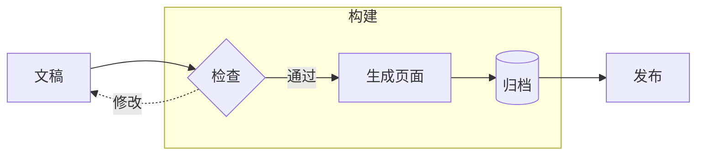

</Tab>

<Tab label="时序图">

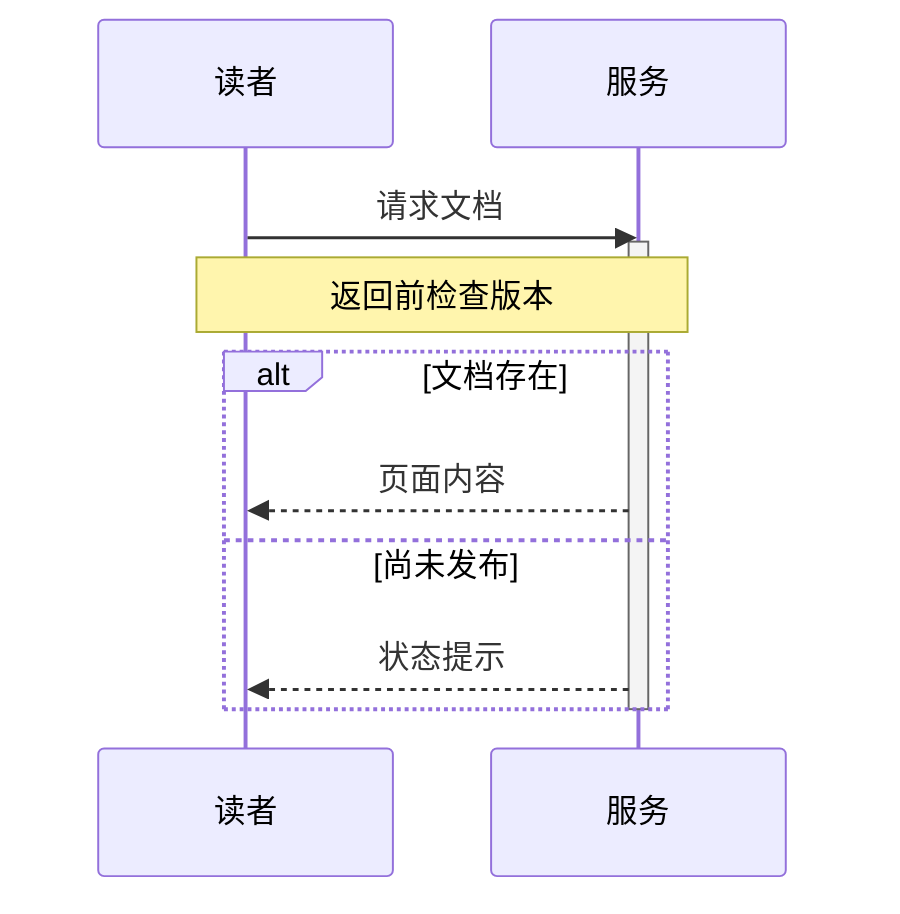

</Tab>

<Tab label="类图">

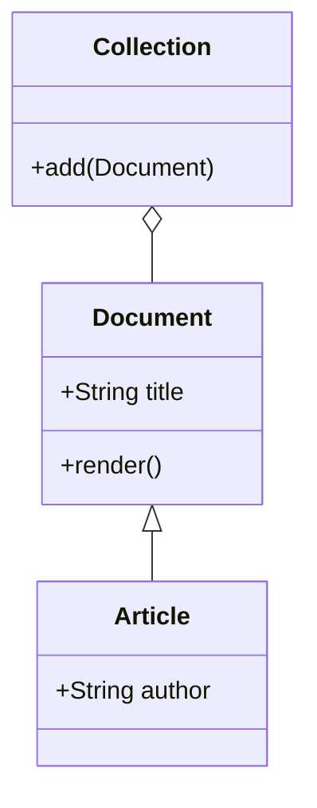

</Tab>

<Tab label="状态图">

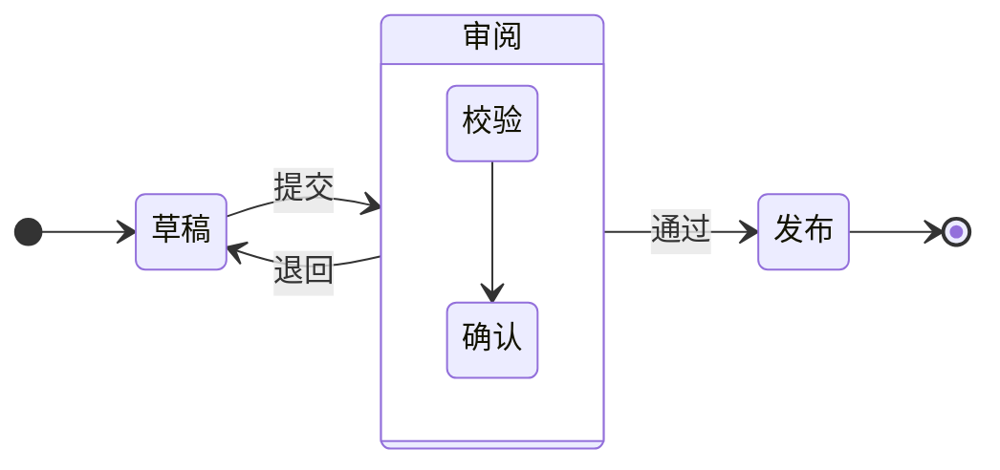

</Tab>

<Tab label="实体关系图">

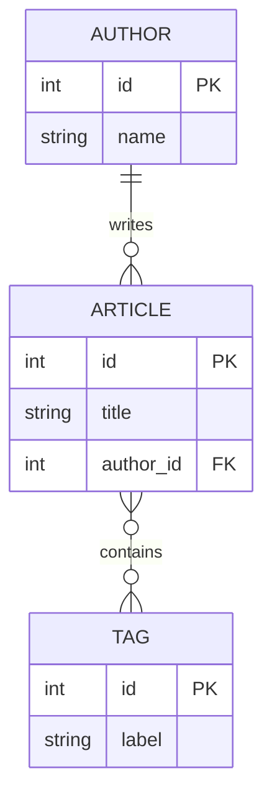

</Tab>

</Tabs>

</Tab>

<Tab label="分类与数据">

<Tabs keepDOM={false}>

<Tab label="饼图">

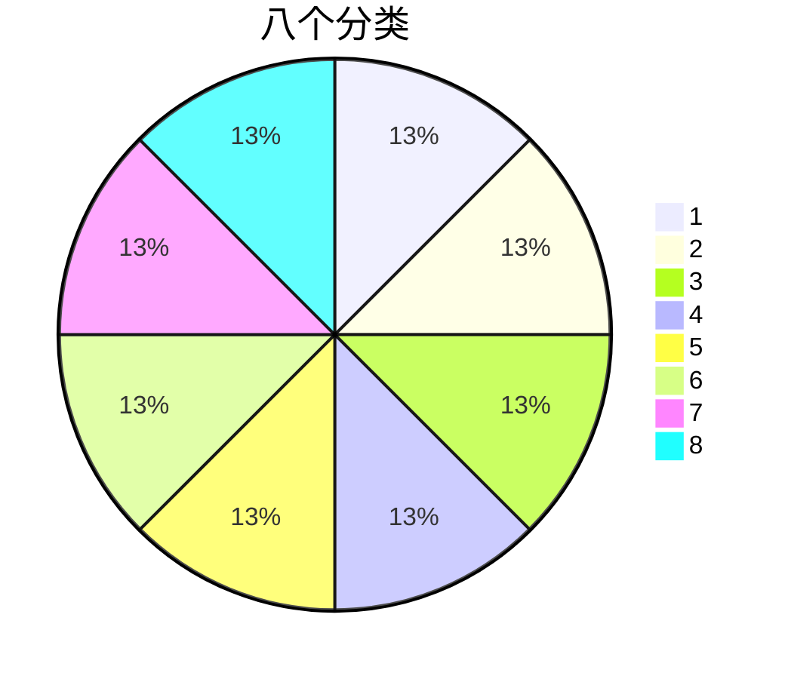

</Tab>

<Tab label="Git 提交图">

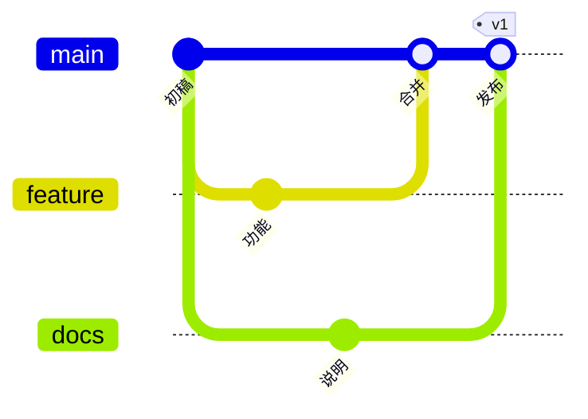

</Tab>

<Tab label="思维导图">

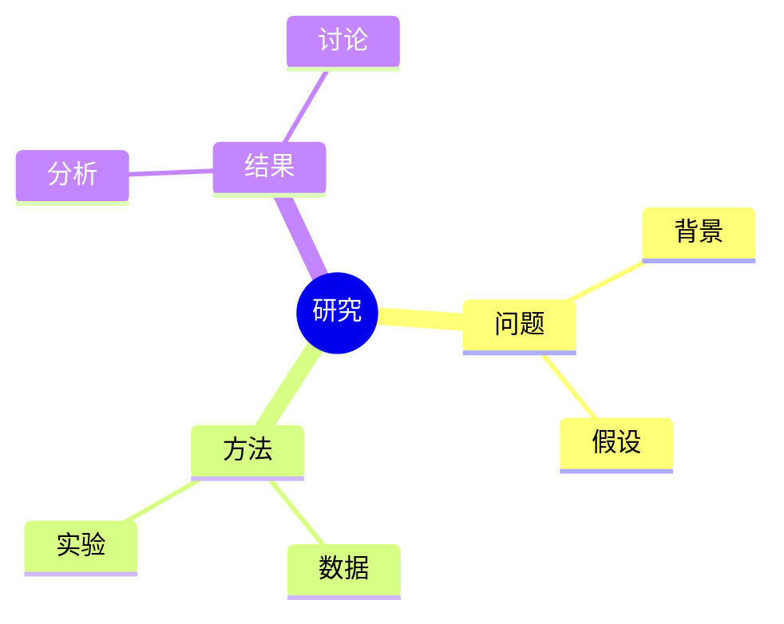

</Tab>

<Tab label="XY 图">

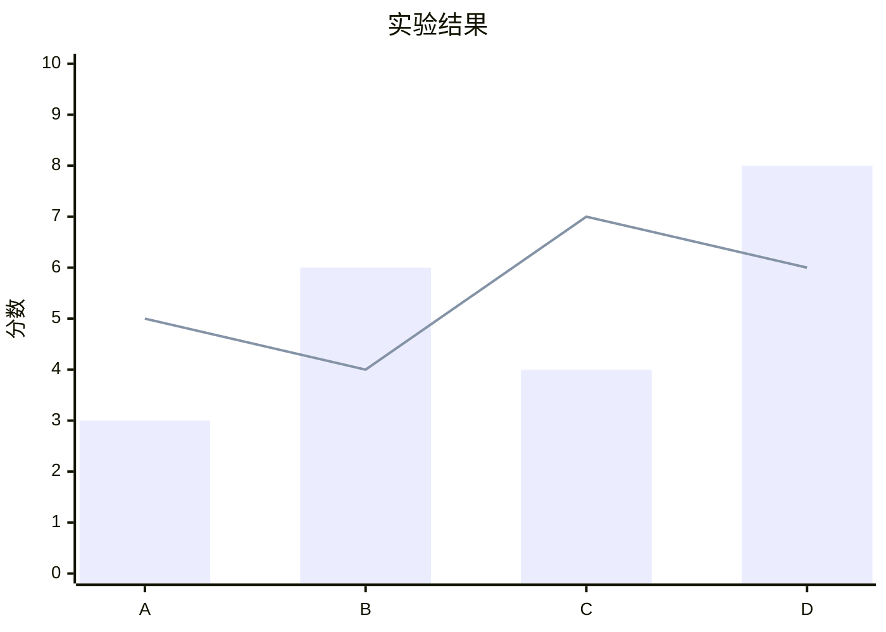

</Tab>

<Tab label="象限图">

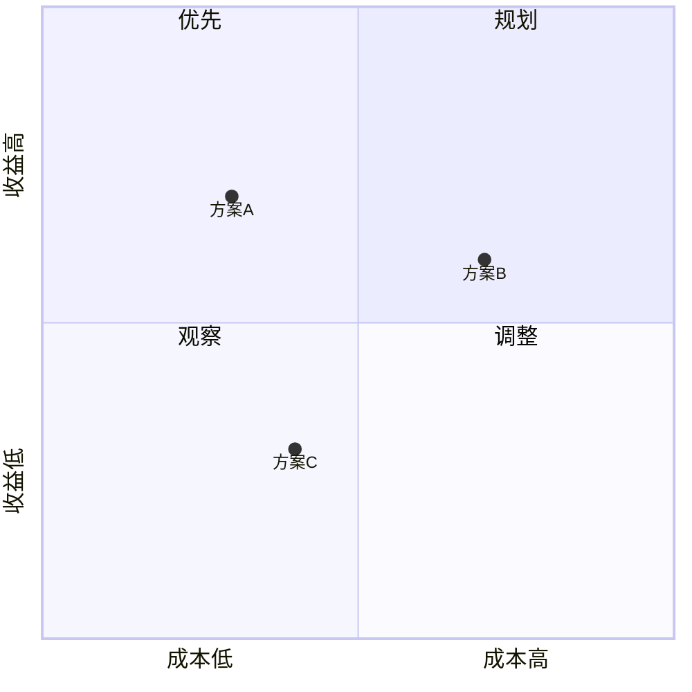

</Tab>

</Tabs>

</Tab>

<Tab label="进度与状态">

<Tabs keepDOM={false}>

<Tab label="甘特图">

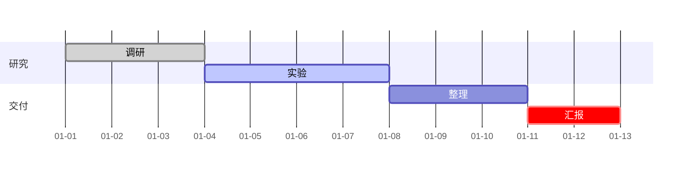

</Tab>

<Tab label="用户旅程图">

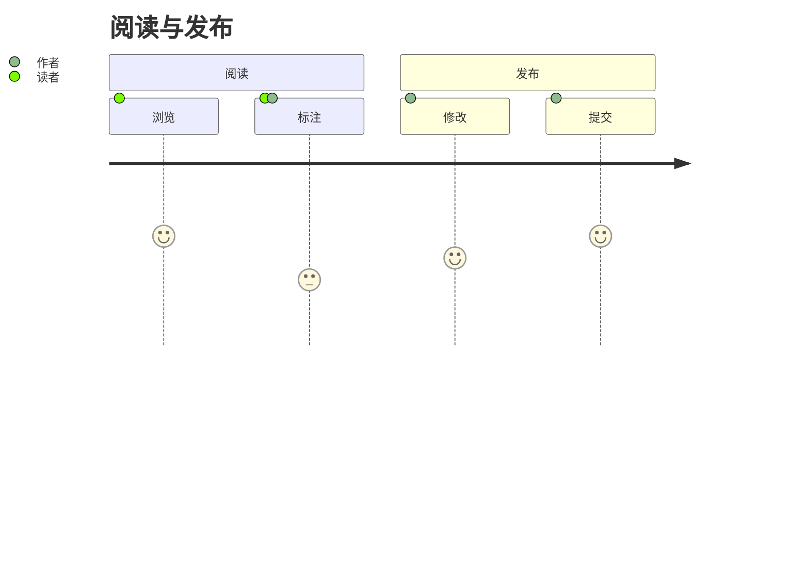

</Tab>

<Tab label="时间线">

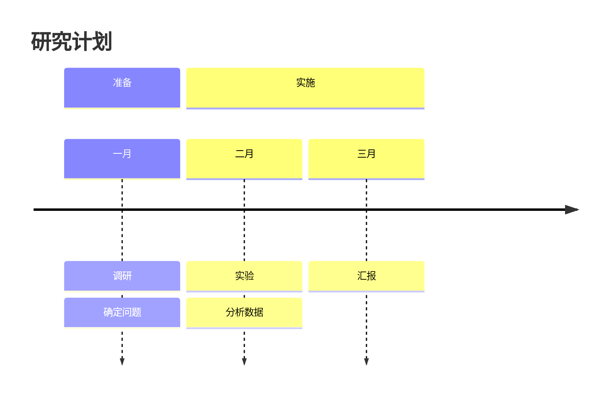

</Tab>

</Tabs>

</Tab>

</Tabs>

<Callout type="details" title="显示职责">

分类色复用从品牌基准色衍生的 [OKLCH](https://developer.mozilla.org/zh-CN/docs/Web/CSS/color_value/oklch) 八色，亮暗保持类别顺序。下载内容可直接传给 `mermaid.initialize()`。

<CinderfolioPreview section="mermaid-roles" />

</Callout>
