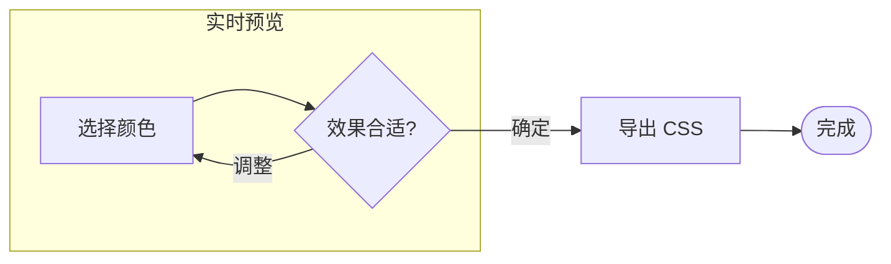
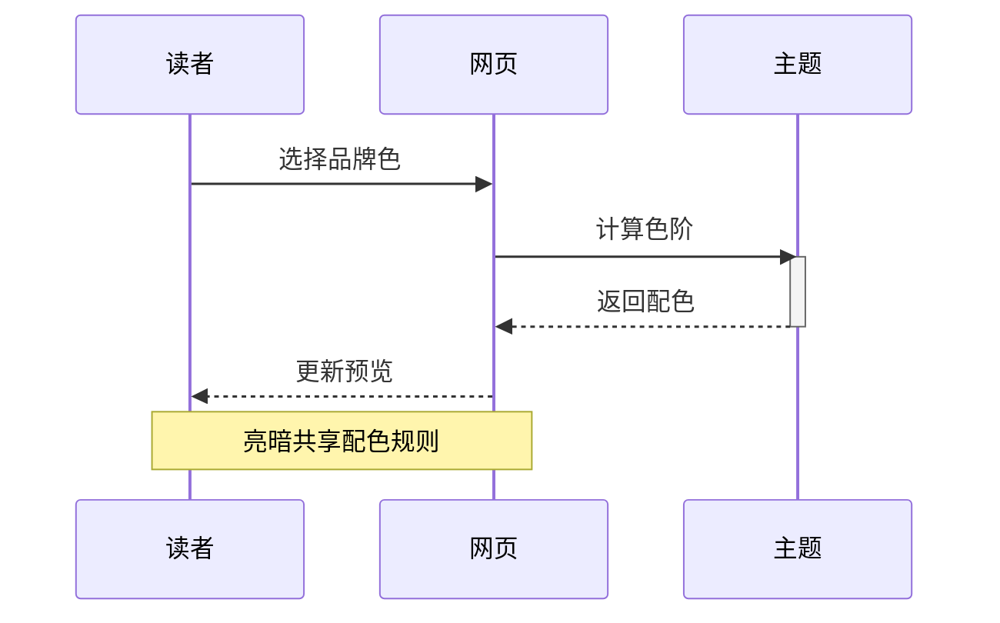
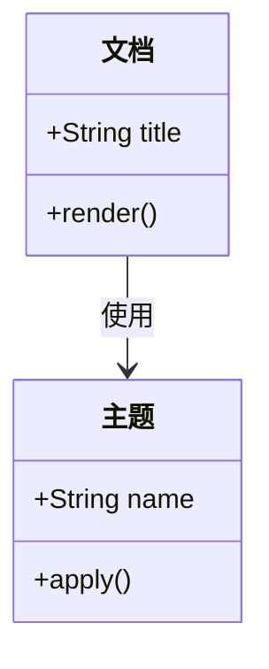
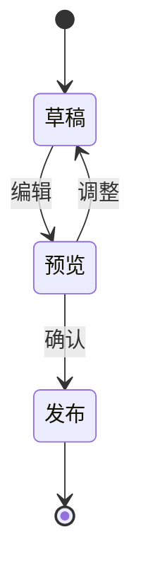
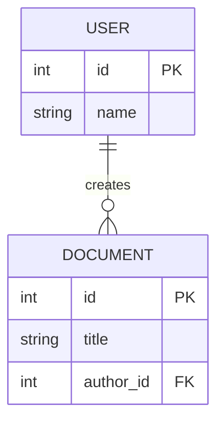
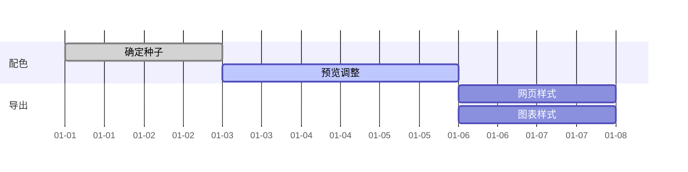
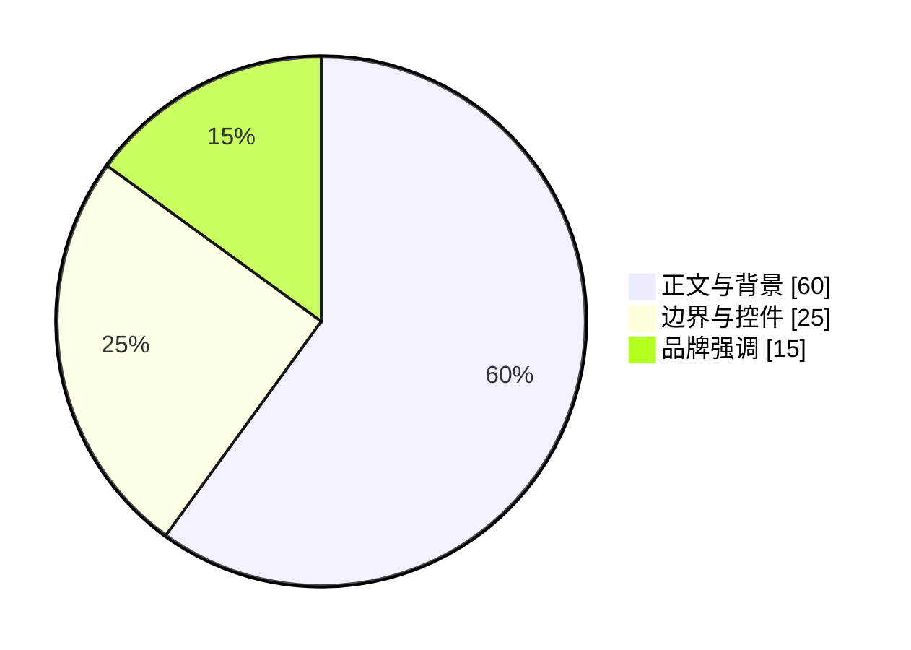
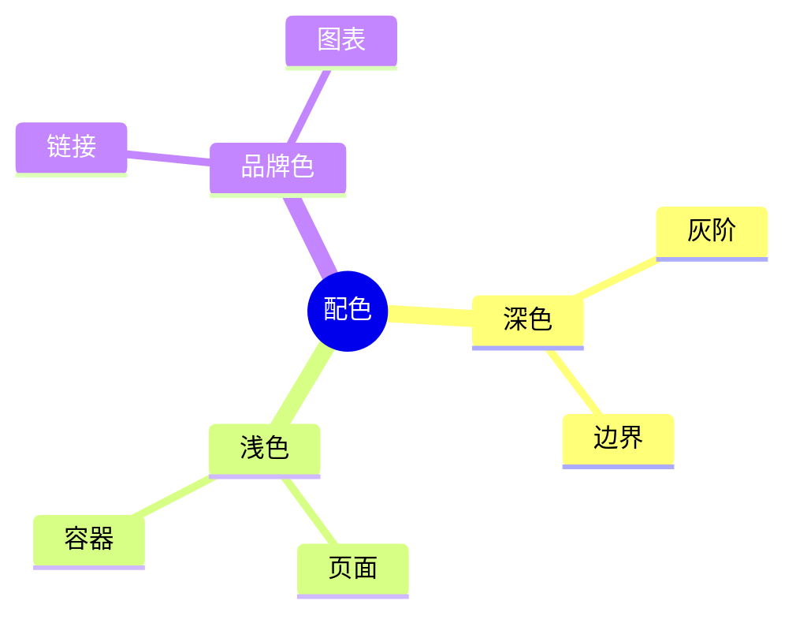

# Cinderfolio-Pele

[Pele](https://github.com/obsidianmd/pele) 是轻量的 Mermaid 渲染器，输出可主题化的 SVG。

<CinderfolioPreview section="controls" />

<CinderfolioDownload target="pele" />

## 流程图

## 时序图

## 类图

## 状态图

## 实体关系图

## 甘特图

## 饼图

## 思维导图

