import { Callout, Tab, Tabs } from '@rspress/core/theme';

{/*
图表语法参考 https://pele.run/examples.md，精简为配色检查样例。

MIT License

Copyright (c) 2026 kepano

Permission is hereby granted, free of charge, to any person obtaining a copy
of this software and associated documentation files (the "Software"), to deal
in the Software without restriction, including without limitation the rights
to use, copy, modify, merge, publish, distribute, sublicense, and/or sell
copies of the Software, and to permit persons to whom the Software is
furnished to do so, subject to the following conditions:

The above copyright notice and this permission notice shall be included in all
copies or substantial portions of the Software.

THE SOFTWARE IS PROVIDED "AS IS", WITHOUT WARRANTY OF ANY KIND, EXPRESS OR
IMPLIED, INCLUDING BUT NOT LIMITED TO THE WARRANTIES OF MERCHANTABILITY,
FITNESS FOR A PARTICULAR PURPOSE AND NONINFRINGEMENT. IN NO EVENT SHALL THE
AUTHORS OR COPYRIGHT HOLDERS BE LIABLE FOR ANY CLAIM, DAMAGES OR OTHER
LIABILITY, WHETHER IN AN ACTION OF CONTRACT, TORT OR OTHERWISE, ARISING FROM,
OUT OF OR IN CONNECTION WITH THE SOFTWARE OR THE USE OR OTHER DEALINGS IN THE
SOFTWARE.
*/}

# Cinderfolio-Pele

[Pele](https://github.com/obsidianmd/pele) 将 Mermaid 渲染为 SVG。选择图例后调整配色，观察对应的文字、结构与填充。

<div className="cf-pele-preview">

<CinderfolioPreview section="controls">
  <CinderfolioDownload target="pele" />
</CinderfolioPreview>

<Tabs className="cf-tabs cf-pele-categories">

<Tab label="框线与结构">

<Tabs>

<Tab label="流程图">

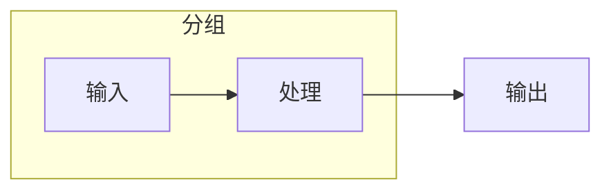

</Tab>

<Tab label="时序图">

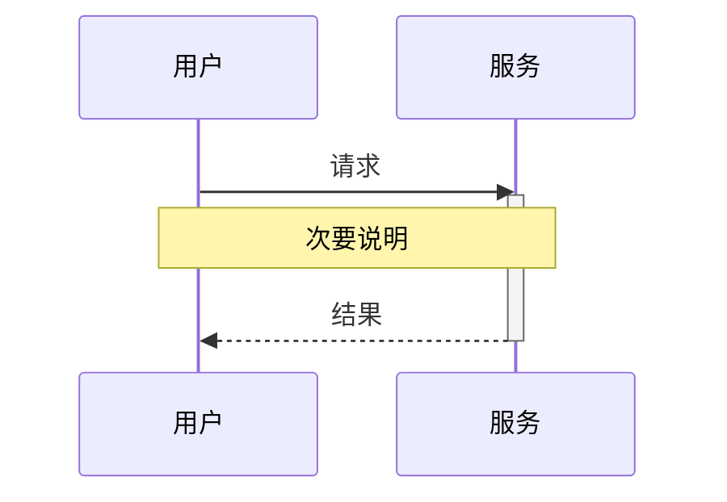

</Tab>

<Tab label="类图">

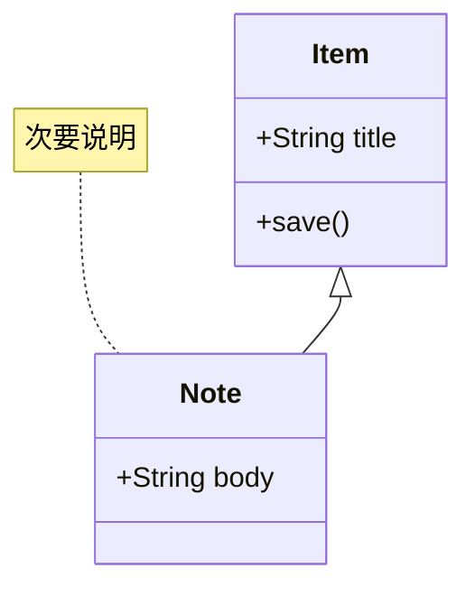

</Tab>

<Tab label="状态图">

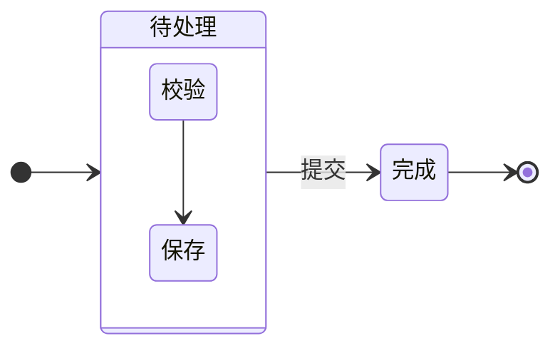

</Tab>

<Tab label="实体关系图">

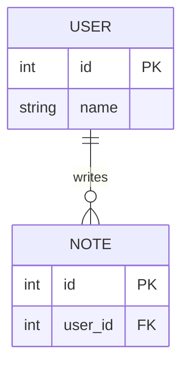

</Tab>

<Tab label="块图">

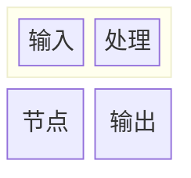

</Tab>

<Tab label="C4 架构图">

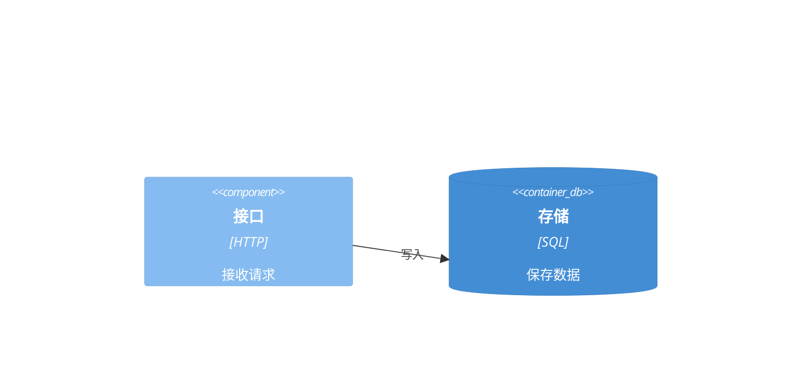

</Tab>

<Tab label="数据包图">

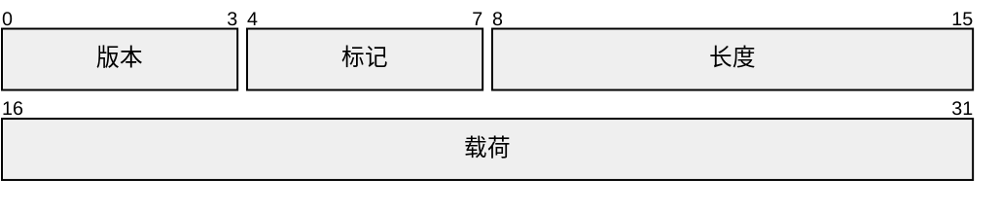

</Tab>

<Tab label="需求图">

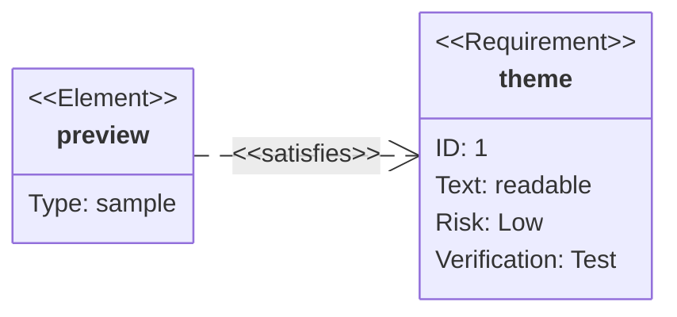

</Tab>

<Tab label="架构图">


</Tab>

<Tab label="鱼骨图">

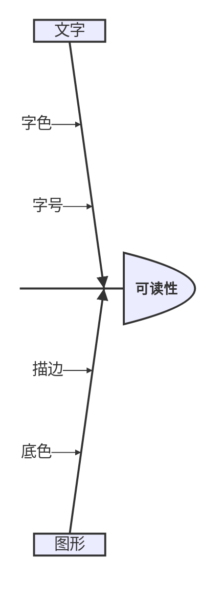

</Tab>

<Tab label="语法铁路图">

```mermaid
railroad-ebnf-beta
    value = "数值" ( ( "+" | "-" ) "数值" )* ;
```

</Tab>

<Tab label="泳道图">

```mermaid
swimlane-beta LR
    subgraph 用户
        request[提交]
        receive[接收]
    end
    subgraph 服务
        save[保存]
    end
    request --> save --> receive
```

</Tab>

<Tab label="目录树">


</Tab>

<Tab label="用例图">

```mermaid
usecase-beta
    direction LR
    actor Reader
    systemBoundary Notes
        Read("阅读")
        Edit("编辑")
    end
    Reader --> Read
    Reader --> Edit
    Edit ..> : include Read
```

</Tab>

</Tabs>

</Tab>

<Tab label="分类与实底">

<Tabs>

<Tab label="饼图">

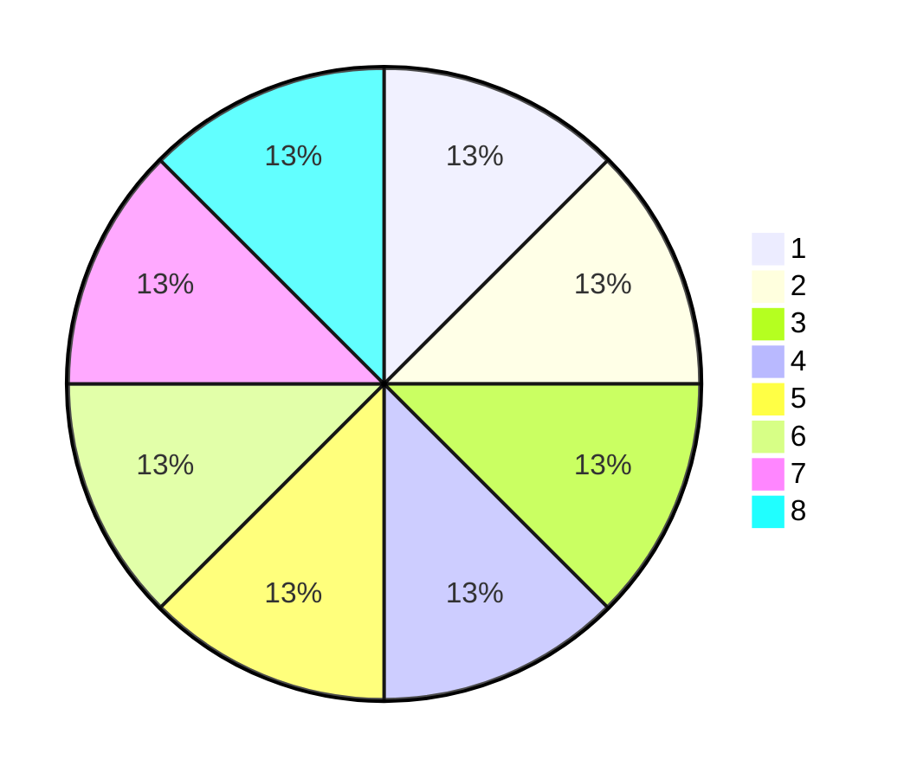

</Tab>

<Tab label="思维导图">

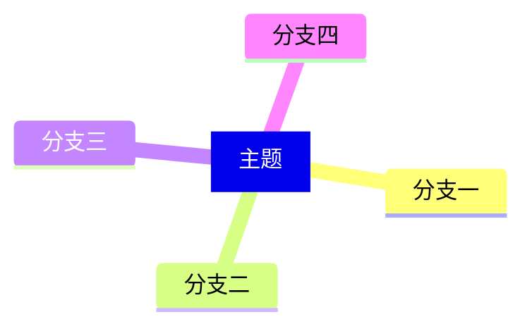

</Tab>

<Tab label="Git 提交图">

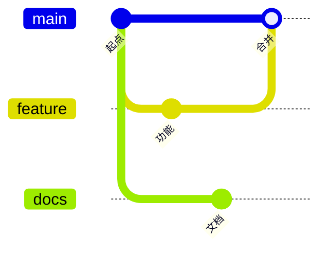

</Tab>

<Tab label="象限图">

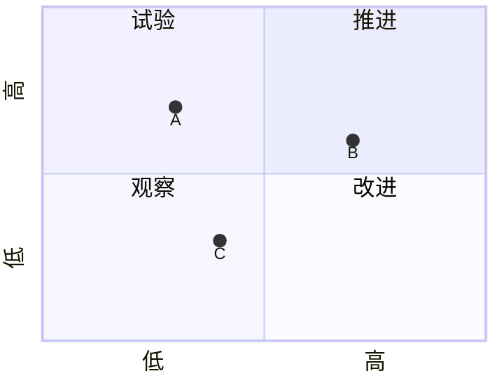

</Tab>

<Tab label="时间线">

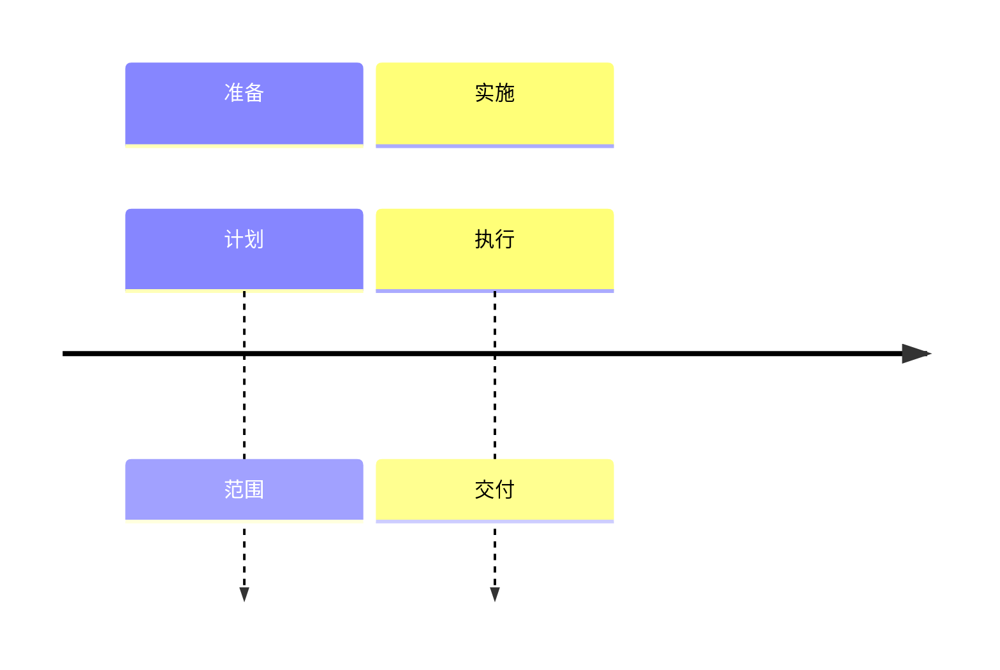

</Tab>

<Tab label="用户旅程图">

```mermaid
journey
    section 准备
        阅读: 5: 用户
        配色: 3: 用户, 设计
    section 完成
        检查: 1: 设计
```

</Tab>

<Tab label="XY 图">

```mermaid
---
config:
  xyChart:
    width: 440
    height: 280
---
xychart
    x-axis [A, B, C, D]
    y-axis 0 --> 10
    bar [3, 6, 4, 8]
    line [5, 4, 7, 6]
```

</Tab>

<Tab label="矩形树图">

```mermaid
---
config:
  treemap:
    nodeWidth: 44
    nodeHeight: 24
---
treemap-beta
"内容"
    "笔记"
        "基础": 4
        "进阶": 3
    "项目"
        "设计": 2
        "开发": 3
```

</Tab>

</Tabs>

</Tab>

<Tab label="透明与叠色">

<Tabs>

<Tab label="雷达图">

```mermaid
---
config:
  radar:
    width: 360
    height: 260
---
radar-beta
    axis text["文字"], line["连线"], fill["填充"], border["描边"]
    curve a["方案 A"]{4, 2, 4, 3}
    curve b["方案 B"]{2, 4, 3, 4}
    graticule polygon
    max 5
```

</Tab>

<Tab label="韦恩图">

```mermaid
venn-beta
    set A["文字"]
        text A1["清晰"]
    set B["图形"]
        text B1["协调"]
    union A,B["重叠"]
        text AB1["可读"]
```

</Tab>

<Tab label="桑基图">

```mermaid
---
config:
  sankey:
    width: 440
    height: 240
    showValues: false
---
sankey
Input A,Process,4
Input B,Process,3
Process,Output,7
```

</Tab>

<Tab label="事件建模图">

```mermaid
eventmodeling
    timeframe 01 ui View
    timeframe 02 command Save
    timeframe 03 event Saved
```

</Tab>

<Tab label="智能体流程图">

```mermaid
agentflow-beta LR
    flow input["输入组"]
        receive["接收"]@{ shape: input }
    end
    flow output["处理组"]
        check["校验"]@{ shape: task }
        save["保存"]@{ shape: action }
        check --> save
    end
    receive --> check
```

</Tab>

<Tab label="Cynefin 框架图">

```mermaid
---
config:
  cynefin:
    width: 440
    height: 280
    showDomainDescriptions: false
---
cynefin-beta
    complex
        "探索"
    complicated
        "分析"
    clear
        "执行"
    chaotic
        "应急"
    complex --> complicated : "识别"
    chaotic --> clear : "稳定"
```

</Tab>

</Tabs>

</Tab>

<Tab label="强调与状态">

<Tabs>

<Tab label="甘特图">

```mermaid
---
config:
  gantt:
    useWidth: 520
    leftPadding: 64
    rightPadding: 16
---
gantt
    dateFormat YYYY-MM-DD
    axisFormat %m-%d
    todayMarker off
    section 任务
        普通任务 :normal, 2026-01-01, 4d
        进行中   :active, current, 2026-01-02, 4d
        已完成   :done, finished, 2026-01-01, 3d
        关键任务 :crit, important, 2026-01-03, 4d
```

</Tab>

<Tab label="看板">

```mermaid
kanban
    待处理
        normal[普通任务]
        critical[关键任务]@{ priority: 'Very High' }
    进行中
        active[更新主题]@{ priority: 'High', assigned: '设计' }
```

</Tab>

<Tab label="Wardley 地图">

```mermaid
---
config:
  wardley-beta:
    width: 520
    height: 300
---
wardley-beta
    anchor User [0.95, 0.5]
    component App [0.75, 0.3]
    component Storage [0.4, 0.5]
    User -> App
    App -> Storage
    evolve Storage 0.8
```

</Tab>

</Tabs>

</Tab>

</Tabs>

<Callout type="details" title="显示职责">

分类色以品牌基准色为起点，使用 OKLCH 生成八色，并对色觉模拟中的明显冲突作小幅校正；暗色主题保持同一类别顺序并降低明度。图例沿用原生透明度，实底文字随深浅端点适配。

<CinderfolioPreview section="pele-roles" />

</Callout>

</div>
