{/*
以下示例选自 https://pele.run/examples.md，保留官方源码。

MIT License

Copyright (c) 2026 kepano

Permission is hereby granted, free of charge, to any person obtaining a copy
of this software and associated documentation files (the "Software"), to deal
in the Software without restriction, including without limitation the rights
to use, copy, modify, merge, publish, distribute, sublicense, and/or sell
copies of the Software, and to permit persons to whom the Software is
furnished to do so, subject to the following conditions:

The above copyright notice and this permission notice shall be included in all
copies or substantial portions of the Software.

THE SOFTWARE IS PROVIDED "AS IS", WITHOUT WARRANTY OF ANY KIND, EXPRESS OR
IMPLIED, INCLUDING BUT NOT LIMITED TO THE WARRANTIES OF MERCHANTABILITY,
FITNESS FOR A PARTICULAR PURPOSE AND NONINFRINGEMENT. IN NO EVENT SHALL THE
AUTHORS OR COPYRIGHT HOLDERS BE LIABLE FOR ANY CLAIM, DAMAGES OR OTHER
LIABILITY, WHETHER IN AN ACTION OF CONTRACT, TORT OR OTHERWISE, ARISING FROM,
OUT OF OR IN CONNECTION WITH THE SOFTWARE OR THE USE OR OTHER DEALINGS IN THE
SOFTWARE.
*/}

# Cinderfolio-Pele

[Pele](https://github.com/obsidianmd/pele) 是轻量的 Mermaid 渲染器，输出可主题化的 SVG；图表选自[官方示例](https://pele.run/examples.md)。

<CinderfolioPreview section="controls" />

<CinderfolioDownload target="pele" />

## 显示职责

分类色使用 [OKLCH](https://developer.mozilla.org/zh-CN/docs/Web/CSS/color_value/oklch) 的明度、彩度和色相，以品牌色为起点生成亮暗共用、适合深色文字的八色，并对色觉模拟中的明显冲突作小幅校正。

<CinderfolioPreview section="pele-roles" />

## 流程图

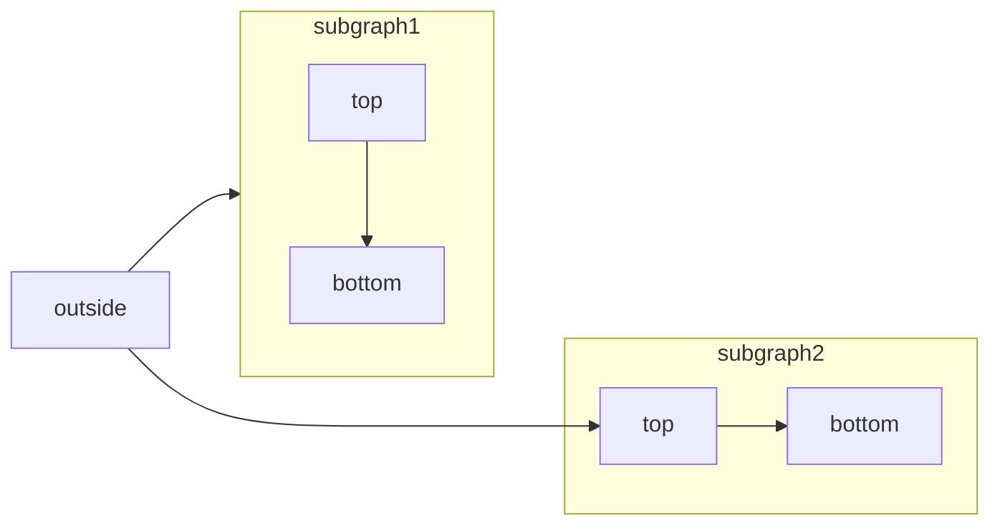

## 时序图

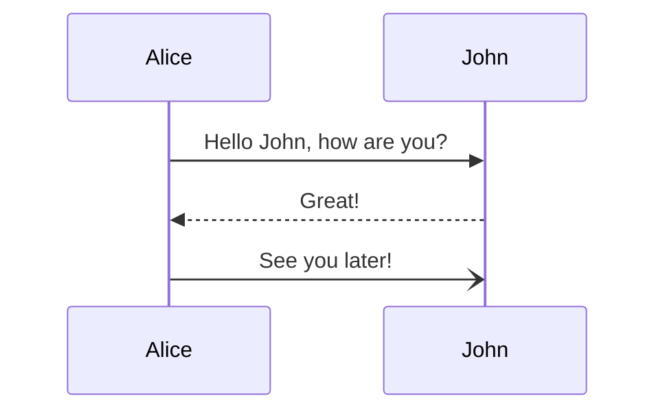

## 类图

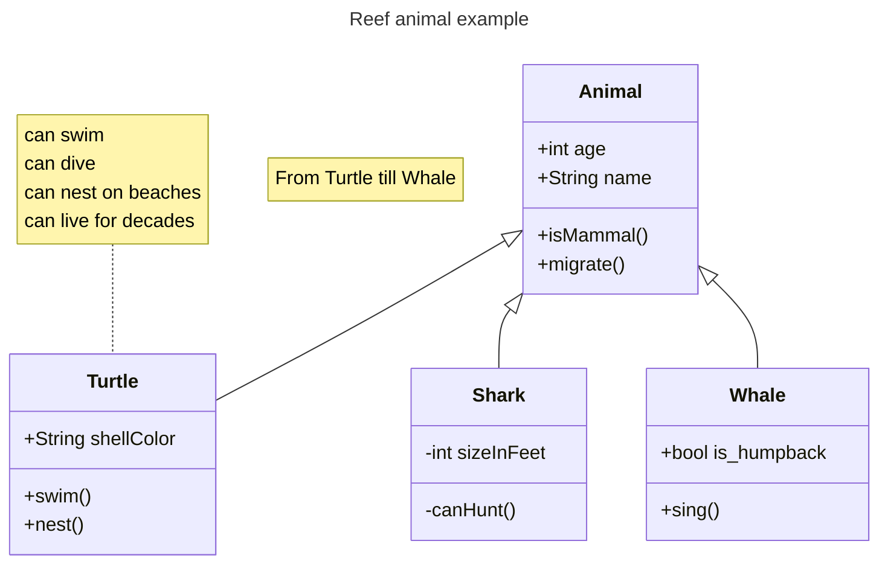

## 状态图

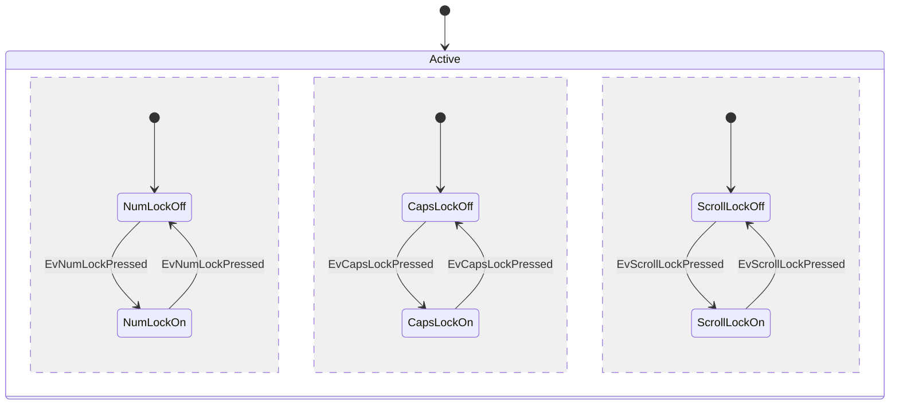

## 实体关系图

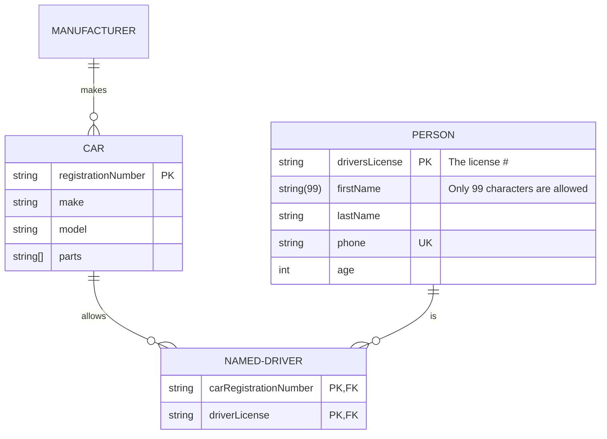

## 甘特图

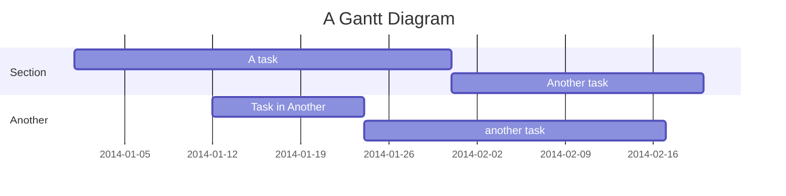

## 饼图

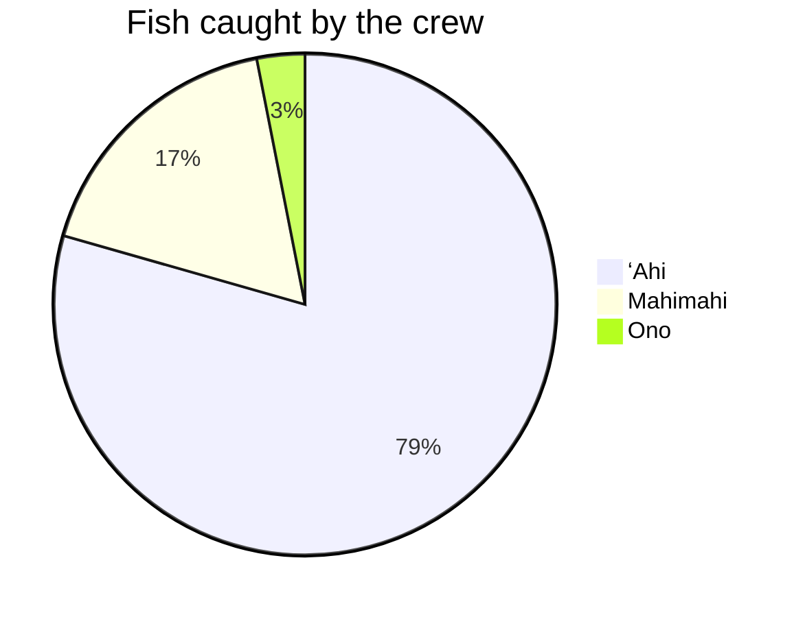

## 思维导图

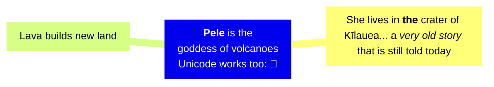

## 块图

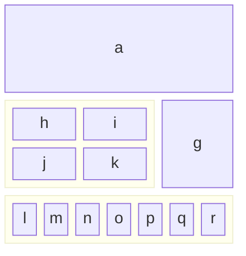

## C4 架构图

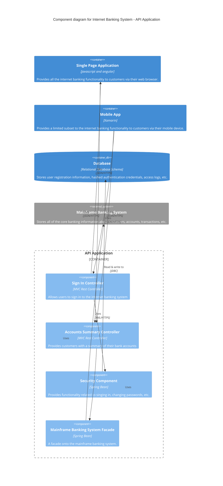

## 事件建模图

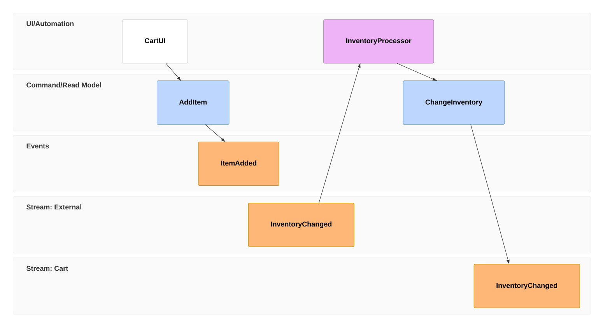

## Git 提交图

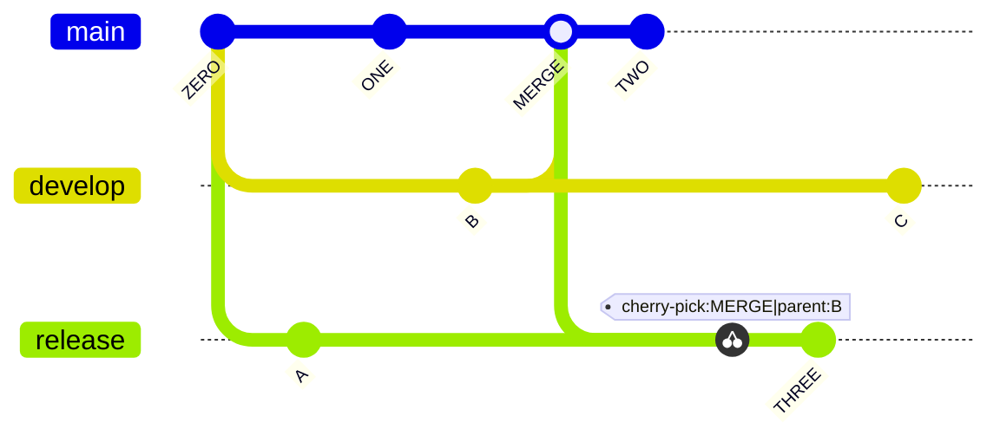

## 看板

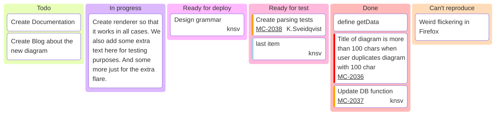

## 数据包图

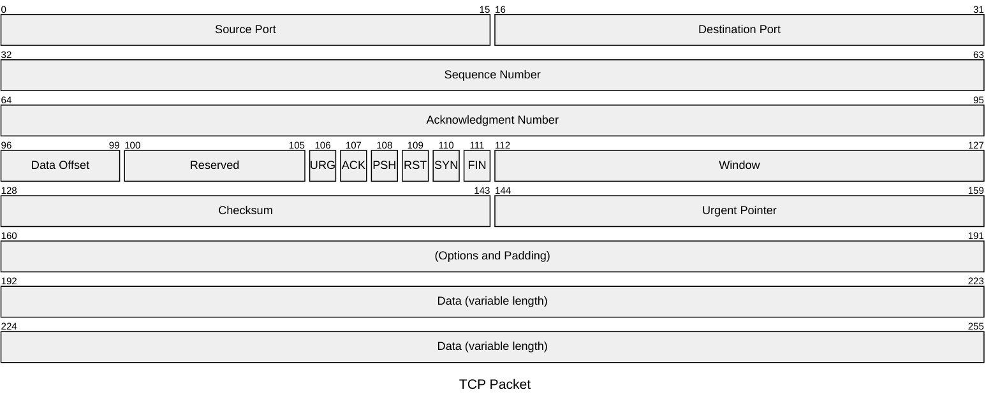

## 象限图

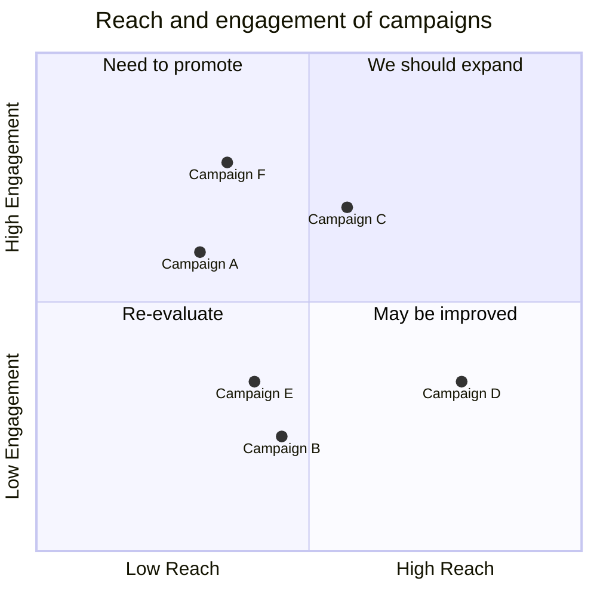

## 需求图

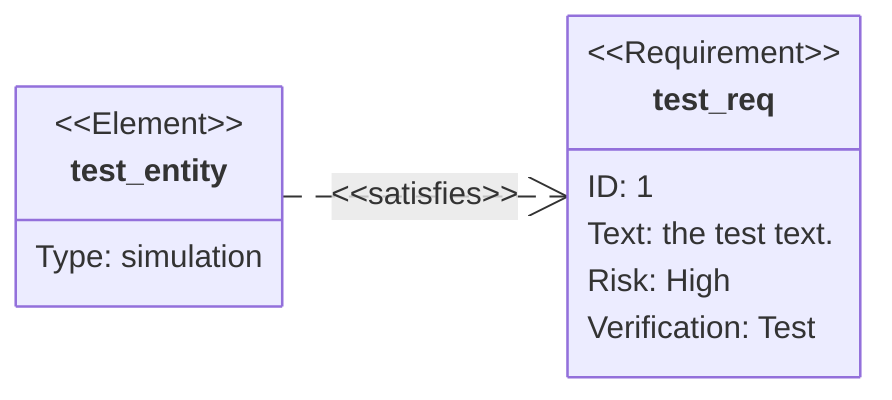

## 桑基图

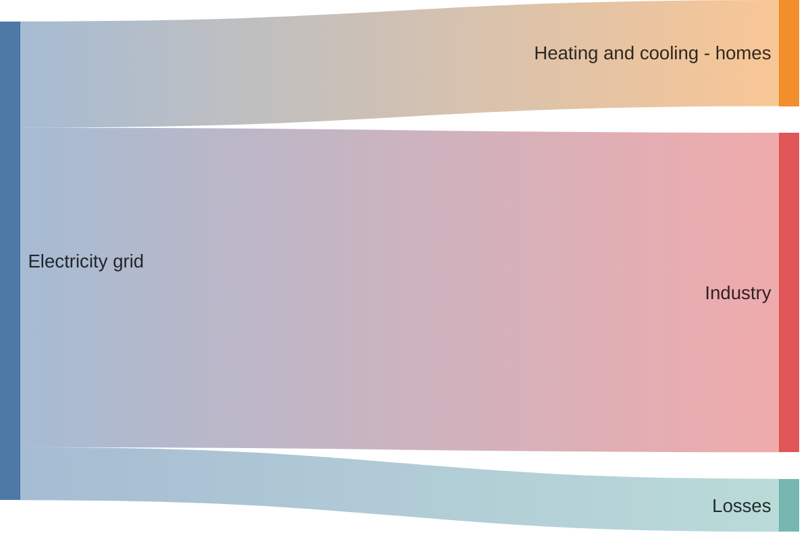

## 时间线

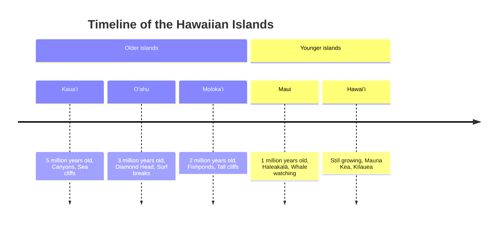

## 用户旅程图

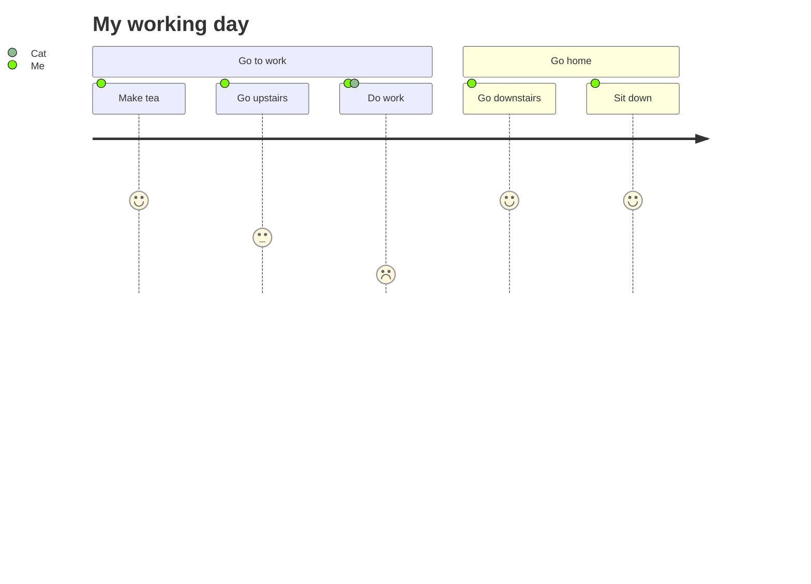

## XY 图

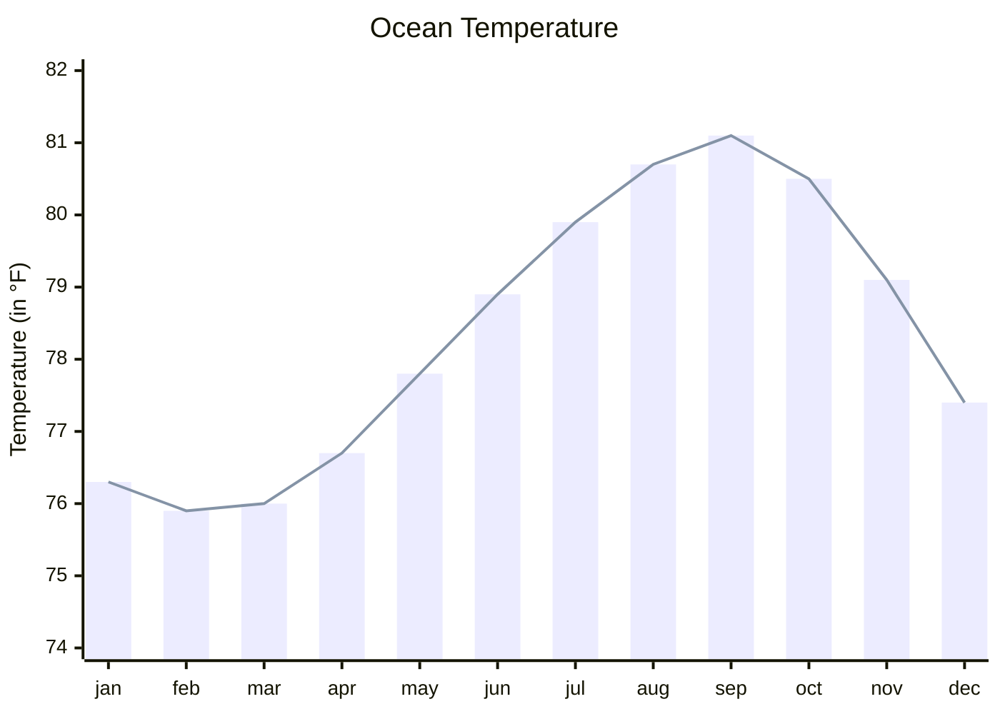

## 智能体流程图

```mermaid
agentflow-beta TB
  flow intake["Intake"]
    receive["Receive request"]@{ shape: input }
  end

  flow processing["Processing"]
    validate["Validate"]@{ shape: task }
    enrich["Enrich"]@{ shape: task }
    validate --> enrich
  end
  processing@{ view: "collapsed" }

  flow output["Output"]
    publish["Publish"]@{ shape: action }
  end

  receive --> validate
  enrich --> publish
```

## 架构图

```mermaid
architecture-beta
    service left_disk(disk)[Disk]
    service top_disk(disk)[Disk]
    service bottom_disk(disk)[Disk]
    service top_gateway(internet)[Gateway]
    service bottom_gateway(internet)[Gateway]
    junction junctionCenter
    junction junctionRight

    left_disk:R -- L:junctionCenter
    top_disk:B -- T:junctionCenter
    bottom_disk:T -- B:junctionCenter
    junctionCenter:R -- L:junctionRight
    top_gateway:B -- T:junctionRight
    bottom_gateway:T -- B:junctionRight
```

## Cynefin 框架图

```mermaid
cynefin-beta
  title Strategy Categorization

  complex
    "Market research"

  complicated
    "Competitive analysis"

  clear
    "Standard pricing"

  chaotic
    "Crisis management"

  complex --> complicated : "Pattern identified"
  complicated --> clear : "Best practice codified"
  clear --> chaotic : "Complacency"
  chaotic --> complex : "Stabilized"
```

## 鱼骨图

```mermaid
ishikawa-beta
    Blurry Photo
    Process
        Out of focus
        Shutter speed too slow
        Protective film not removed
        Beautification filter applied
    User
        Shaky hands
    Equipment
        LENS
            Inappropriate lens
            Damaged lens
            Dirty lens
        SENSOR
            Damaged sensor
            Dirty sensor
    Environment
        Subject moved too quickly
        Too dark
```

## 雷达图

```mermaid
radar-beta
  title Restaurant Comparison
  axis food["Food Quality"], service["Service"], price["Price"]
  axis ambiance["Ambiance"]

  curve a["Restaurant A"]{4, 3, 2, 4}
  curve b["Restaurant B"]{3, 4, 3, 3}
  curve c["Restaurant C"]{2, 3, 4, 2}
  curve d["Restaurant D"]{2, 2, 4, 3}

  graticule polygon
  max 5
```

## 语法铁路图

```mermaid
railroad-ebnf-beta
title "Arithmetic Expression Grammar"

expression = term ( ( "+" | "-" ) term )* ;
term = factor ( ( "*" | "/" ) factor )* ;
factor = number | "(" expression ")" ;
number = digit+ ;
digit = "0" | "1" | "2" | "3" | "4" | "5" | "6" | "7" | "8" | "9" ;
```

## 泳道图

```mermaid
swimlane-beta LR
  subgraph Customer
    request[Request service]
    receive[Receive update]
  end

  subgraph Support
    triage[Triage request]
    answer[Send answer]
  end

  subgraph Engineering
    investigate[Investigate issue]
    fix[Prepare fix]
  end

  request --> triage
  triage -->|Known issue| answer
  triage -->|Needs code change| investigate
  investigate --> fix --> answer
  answer --> receive
```

## 目录树

```mermaid
---
config:
  treeView:
    showIcons: true
    defaultIconPack: material-icon-theme
    filenameIcons:
      Dockerfile: docker
    extensionIcons:
      .ts: typescript
      .tsx: react-ts
      .txt: none
---
treeView-beta
    src/
        App.tsx
        utils.ts
    Dockerfile
    notes.txt
    README.md
```

## 矩形树图

```mermaid
---
config:
  treemap:
    valueFormat: '$0,0'
---
treemap-beta
"Budget"
    "Operations"
        "Salaries": 700000
        "Equipment": 200000
        "Supplies": 100000
    "Marketing"
        "Advertising": 400000
        "Events": 100000
```

## 用例图

```mermaid
---
config:
  theme: default
  look: classic
  layout: dagre
---
usecase-beta
direction LR
actor Customer
actor Support
systemBoundary Storefront
  Browse("Browse catalog")
  Checkout("Checkout")
end
systemBoundary Fulfilment
  Track("Track delivery")
end
Customer --> Browse
Customer --> Checkout
Customer --> Track
Support --> Track
Checkout ..> : include Browse
```

## 韦恩图

```mermaid
venn-beta
  set A["Frontend"]
    text A1["React"]
    text A2["Design Systems"]
  set B["Backend"]
    text B1["API"]
  union A,B["Shared"]
    text AB1["OpenAPI"]
```

## Wardley 地图

```mermaid
wardley-beta
title Tea Shop Value Chain

anchor Business [0.95, 0.63]
component Cup of Tea [0.79, 0.61]
component Tea [0.63, 0.81]
component Hot Water [0.52, 0.80]
component Kettle [0.43, 0.35]
component Power [0.10, 0.70]

Business -> Cup of Tea
Cup of Tea -> Tea
Cup of Tea -> Hot Water
Hot Water -> Kettle
Kettle -> Power

evolve Kettle 0.62
evolve Power 0.89

note "Standardizing power allows Kettles to evolve faster" [0.30, 0.49]
```
