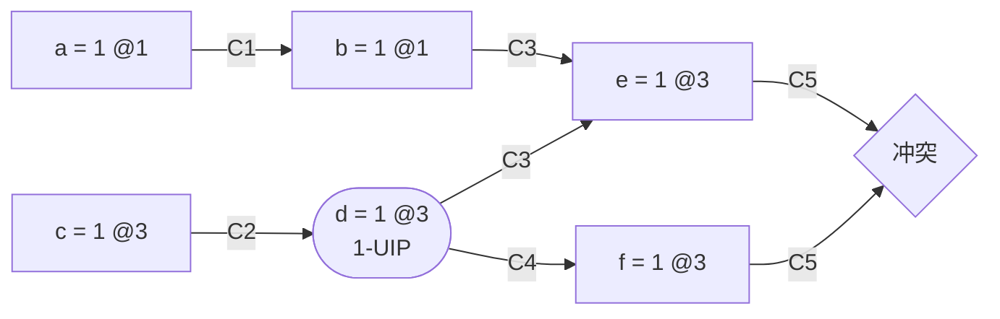

<!-- _class: cover -->
<!-- _paginate: skip -->
<!-- _header: "" -->
<!-- _footer: "" -->

# SAT 求解 <small>从 DPLL 到 CDCL</small>

ShiJin

2026 年 10 月

<!-- 前置知识：布尔逻辑、集合与递归。参考文献使用 2021 年第二版 Handbook of Satisfiability 与 MiniSat 扩展稿；完整推导见配套知识笔记。 -->

---

## 阅读路线

1. **[SAT 与 DPLL](#3)**：从布尔约束开始，建立完整的分支搜索。
2. **[冲突分析](#8)**：记录传播原因，用归结解释一次失败。
3. **[学习与回跳](#14)**：让学习子句决定回跳位置和下一次传播。
4. **[实现概览](#17)**：在保持逻辑依据的前提下，减少搜索与传播成本。

<!-- 先理解完整搜索，再用同一个例子串起冲突分析、学习子句和回跳。最后概括实现与启发式；完整实现算例在第二篇展开。页眉可跳转至各章，两种比例使用相同页序。 -->

---

<!-- header: '**[SAT 与 DPLL](#3)** [冲突分析](#8) [学习与回跳](#14) [实现概览](#17)' -->
<!-- _class: transition -->

01

## SAT 与 DPLL

从布尔约束开始，建立完整的分支搜索。

---

## SAT 与搜索中的边界情况

$$
F=(a\lor b)\land(\neg a\lor c)\land(\neg b\lor c)
$$

$a=1,\ b=0,\ c=1$ 满足全部子句，因此这个公式是 **SAT**。

<div class="cf-cols">
<div class="cf-col">

### 剩余公式为空

$$
F=\varnothing
$$

约束全部满足，当前赋值可以补全。

</div>
<div class="cf-col">

### 出现空子句

$$
\varnothing\in F
$$

当前分支冲突，需要回溯。

</div>
</div>

找到模型可回答 SAT；完整排除模型后才能回答 UNSAT。

<!-- 文字是变量或其否定，子句是文字的析取，CNF 是子句的合取。求解器可以返回部分模型，但必须保证它能补全为满足原公式的赋值。来源：[1] §3.2。

空合取为真，空析取为假。在递归搜索中，冲突针对当前部分赋值；只有排除所有分支或在根层证明冲突，才能判断原公式 UNSAT。来源：[1] pp. 101–102。 -->

---

## 单位传播先做被迫的赋值

$$
(a)\land(\neg a\lor b)\land(\neg b\lor c)\land(\neg c)
$$

$$
a=1\ \Longrightarrow\ b=1\ \Longrightarrow\ c=1
\ \Longrightarrow\ \bot
$$

一个子句的其余文字均为假、只剩一个未赋值文字时，
将这个文字置真。

**重复传播，直到没有新赋值或发现冲突。**

<!-- 这里固定从左到右的一种传播顺序。也可以先由最后一个单位子句得到 c=0，最终同样会冲突，但最先报告的冲突子句可能不同。未赋值是实现状态，不是布尔逻辑中的第三种真值。来源：[1] §3.5.2。 -->

---

## 没有单位子句，也可能不可满足

$$
\begin{aligned}
G={}&(x\lor y)\land(x\lor\neg y)\\
   &\land(\neg x\lor y)\land(\neg x\lor\neg y)
\end{aligned}
$$

取 $x=1$：后两个子句要求 $y=1$ 和 $y=0$。

取 $x=0$：前两个子句要求 $y=1$ 和 $y=0$。

> [!IMPORTANT]
> 传播没有发现冲突，不等于已经找到模型。

<!-- 这个四子句例子说明单位传播不是完整的 SAT 判定方法。需要分支搜索或者更强的推理。来源：[1] pp. 103, 115–116；公式与分支分析可直接逐项核对。 -->

---

<!-- _class: compact sat-algorithm -->

## DPLL 的搜索与完备性

<div class="cf-cols">
<div class="cf-col cf-w3">

```pseudocode
\begin{algorithm}
\caption{DPLL}
\begin{algorithmic}
\FUNCTION{DPLL}{$F, \alpha$}
    \STATE $(F, \alpha) \gets$ \CALL{PropagateToFixpoint}{$F, \alpha$}
    \IF{$\varnothing \in F$}
        \RETURN \textsc{Unsat}
    \ENDIF
    \IF{$F = \varnothing$}
        \RETURN $\alpha$
    \ENDIF
    \STATE $x \gets$ \CALL{ChooseVariable}{$F$}
    \FORALL{$\ell \in \{x, \neg x\}$}
        \STATE $F' \gets$ \CALL{Condition}{$F, \ell$}
        \STATE $\alpha' \gets$ \CALL{Extend}{$\alpha, \ell$}
        \STATE $m \gets$ \CALL{DPLL}{$F', \alpha'$}
        \IF{$m \ne \mathrm{UNSAT}$}
            \RETURN $m$
        \ENDIF
    \ENDFOR
    \RETURN \textsc{Unsat}
\ENDFUNCTION
\end{algorithmic}
\end{algorithm}
```

</div>
<div class="cf-col cf-w2">

### 为什么完备

1. **可靠**：传播保留模型。
2. **穷尽**：覆盖两种取值。
3. **有限**：每层固定新变量。

两支都失败才判 UNSAT。

完备不代表多项式时间。

伪代码的辅助过程未展开，不能独立运行。

</div>
</div>

<!-- 初始调用 DPLL(F, 空赋值)。PropagateToFixpoint 在当前分支内传播，直到没有新赋值或发现冲突；Condition 与 Extend 分别生成该分支的剩余公式与赋值副本。空子句表示冲突，空公式表示全部子句已经满足。返回部分模型表示 SAT，返回 UNSAT 表示该分支无解。伪代码中的辅助过程尚未展开，不能独立运行。来源：[1] §3.5。

每个递归分支独立维护剩余公式与赋值。成功时未赋值变量可任意补全；空赋值也可能是合法返回值，因此不能按布尔真假判断模型。资源限制导致的提前退出应报告未完成。来源：[1] §3.5。 -->

---

<!-- header: '[SAT 与 DPLL](#3) **[冲突分析](#8)** [学习与回跳](#14) [实现概览](#17)' -->
<!-- _class: transition -->

02

## 冲突分析

记录传播原因，用归结解释一次失败。

---

## 归结与逻辑后果

$$
\frac{A\lor x\qquad B\lor\neg x}{A\lor B}
$$

若 $A,B$ 都为假，就会同时要求 $x=1$ 和 $x=0$。

因此，归结式是原有子句的逻辑后果：

$$
F_0\models L\quad\Longrightarrow\quad F_0\equiv F_0\land L
$$

<!-- A 和 B 是不含被归结变量的剩余文字析取。加入逻辑后果保留所有模型，但不能随意删除原有前提；DP 变量消除需要处理相应正负子句对。归结的这一含义将在冲突分析中具体出现。来源：[1] §§3.2.1, 3.3.1。 -->

---

## Trail：赋值、决策层与原因

- **值**：真、假或未赋值。
- **决策层**：每次分支增加一层；根层为 $0$。
- **原因**：传播子句，或者“这是一个决策”。

$$
(\neg p\lor\neg q\lor r),\quad p=q=1
\quad\Longrightarrow\quad r=1
$$

保存这个原因，才能在冲突后反向解释 $r$。

<!-- 下一次决策前必须传播到无新赋值且无冲突；发生冲突时可立即停止。蕴含图中的多条入边共同表达一个原因子句，不能把每一条边误读成独立的逻辑蕴含。来源：[2] pp. 135–140。 -->

---

<!-- _class: compact -->

## 例子：公式与传播轨迹

$F=C_1\land\cdots\land C_6$；每次决策后先完成传播。

<div class="cf-cols">
<div class="cf-col">

### 六个子句

$$
\begin{aligned}
C_1&=(\neg a\lor b),\\
C_2&=(\neg c\lor d),\\
C_3&=(\neg d\lor\neg b\lor e),\\
C_4&=(\neg d\lor f),\\
C_5&=(\neg e\lor\neg f),\\
C_6&=(u\lor v).
\end{aligned}
$$

</div>
<div class="cf-col">

### 按决策层记录

$$
\begin{aligned}
1:\;&a=1\xRightarrow{C_1}b=1,\\
2:\;&u=1,\\
3:\;&c=1\xRightarrow{C_2}d=1,\\
&b=d=1\xRightarrow{C_3}e=1,\\
&d=1\xRightarrow{C_4}f=1.
\end{aligned}
$$

</div>
</div>

$C_5=(\neg e\lor\neg f)$ 的两个文字都为假，发生冲突。

**后续分析使用这里记录的传播原因。**

<!-- 该例子使用 8 个变量、6 个子句。u 的决定使 C6 满足，但与接下来的冲突无关，便于展示跳过无关决策层。每次决定之后先完成传播，再进行下一个决定。

处理 d 时先将 e、f 加入传播队列，随后检查 C5，就能产生这里的轨迹。其他合法传播次序可能先得到 f=0，并在 C4 上报冲突。我们不把一种轨迹当成唯一轨迹。 -->

---

<!-- _class: compact -->

## 蕴含图与 1-UIP



- `@k` 表示决策层；第 $2$ 层的 $u$ 与本次冲突无关，图中省略。
- $C_3$ 的两条入边共同表示：$b=d=1$ 才能传播 $e=1$。
- 从 $c$ 到冲突的每条路径都经过 $d$；距冲突最近的必经点 $d$ 是 **1-UIP**。
- 逆序归结至只剩一个当前层文字时停止；1-UIP 不保证子句最短。

<!-- 节点表示已经为真的赋值，@ 后的数字表示决策层，边旁的 C 编号标记原因子句。e 的两个前提 b、d 需要共同成立；同样，冲突节点的两条 C5 入边共同表示 e=f=1 使 C5 的两个文字都为假。当前层从 c 到冲突的路径都经过 d；因此 d 是 1-UIP，c 是更早的 UIP。图由 Mermaid 围栏生成，变量与正文例子一一对应；与冲突无关的 u 不画入图中。

定义中的图限制在当前决策层，低层 b 的赋值作为固定上下文。沿同一当前层归结链继续追到更早的 UIP，低层文字集合可能扩大，回跳层不会因此更低；这有固定推导方式的条件，不能推广到任意子句最小化后的结果。来源：[2] pp. 143–145。 -->

---

<!-- _class: compact -->

## 两次归结得到学习子句

从冲突子句 $R_0=C_5=(\neg e\lor\neg f)$ 出发，沿轨迹逆序分析。

**① 消去 $f$**，使用原因子句 $C_4=(\neg d\lor f)$：

$$
R_1=\operatorname{Res}_f(R_0,C_4)=(\neg e\lor\neg d)
$$

**② 消去 $e$**，使用原因子句 $C_3=(\neg d\lor\neg b\lor e)$：

$$
L=\operatorname{Res}_e(R_1,C_3)=(\neg d\lor\neg b)
$$

$L$ 只剩一个当前层文字 $\neg d$，达到 1-UIP 停止条件。

**$b,d$ 不能同时为真；这个结论不依赖 $u$。**

<!-- 从冲突子句开始，沿 trail 逆序取当前层传播变量，用其原因子句归结。每一步都保留“当前公式蕴含所得子句”这个不变量。这里 e 与 d 仍同属当前层。

重复的 ¬d 只保留一次。L 中只有 ¬d 来自当前第 3 层，¬b 来自第 1 层，因此达到了标准 1-UIP 停止条件。不要继续消去 d 再声称仍是 first UIP。 -->

---

<!-- header: '[SAT 与 DPLL](#3) [冲突分析](#8) **[学习与回跳](#14)** [实现概览](#17)' -->
<!-- _class: transition -->

03

## 学习与回跳

让学习子句决定回跳位置和下一次传播。

---

<!-- _class: compact -->

## 回跳之后，学习子句立即传播

$$
L=(\underbrace{\neg d}_{3}\lor\underbrace{\neg b}_{1})
\qquad\Longrightarrow\qquad 3\to1
$$

保留第 $1$ 层的 $a,b$；撤销 $u,c,d,e,f$。

回跳层取**除唯一当前层文字外**的最大层；单位子句回到根层 $0$。

保留 $b=1$ 后，$L$ 成为单位子句：

$$
(\neg d\lor\neg b)\Longrightarrow d=0\xRightarrow{C_2}c=0
$$

继续搜索，可得到满足全部原始子句的模型：

$$
(a,b,c,d,e,f,u,v)=(1,1,0,0,0,0,1,0)
$$

<!-- 标准断言式回跳取其他文字最大层，不是简单退一层，也不是把某个任意 UIP 的层当作回跳目标。u 虽然无关，也作为 trail 后缀的一部分撤销；回跳不会保留不连续的高层赋值。来源：[2] pp. 143–144。

此时的断言赋值是 d=0，不是直接翻转原决策 c。随后才由 C2 传播 c=0。给出的完整模型逐项满足六个原始子句；它也满足新子句。学习没有把原本的模型排除掉。 -->

---

<!-- _class: sat-algorithm -->

## CDCL 的基本循环

```pseudocode
\begin{algorithm}
\caption{CDCL}
\begin{algorithmic}
\INPUT CNF formula $F$
\OUTPUT A model of $F$, or \textsc{Unsat}
\STATE \CALL{Initialize}{$F$}
\WHILE{\TRUE}
    \STATE $C \gets$ \CALL{Propagate}{}
    \IF{$C \ne \mathrm{None}$}
        \IF{$\operatorname{level}() = 0$}
            \RETURN \textsc{Unsat}
        \ENDIF
        \STATE $(L, j, \ell) \gets$ \CALL{AnalyzeFirstUIP}{$C$}
        \STATE \CALL{Backtrack}{$j$}
        \STATE \CALL{AddClause}{$L$}
        \STATE \CALL{Enqueue}{$\ell, L$}
    \ELIF{\CALL{AllAssigned}{}}
        \RETURN \CALL{Assignment}{}
    \ELSE
        \STATE \CALL{Decide}{\CALL{ChooseLiteral}{}}
    \ENDIF
\ENDWHILE
\end{algorithmic}
\end{algorithm}
```

<!-- 伪代码中的辅助过程没有展开，不是可独立运行的程序。C 为冲突子句，None 表示没有冲突；空子句仍属于冲突。AnalyzeFirstUIP 显式返回学习子句 L、回跳层 j 和断言文字 l。Initialize 初始化公式、赋值轨迹和根层传播队列；Enqueue 的第二个参数是原因子句；Decide 合并新建决策层与记录无原因的决策赋值。返回模型表示 SAT，返回 UNSAT 表示无解。省略重启、子句删除和预处理。传播必须发生在下一次决策之前。根层冲突不依赖分支假设，可以推出 UNSAT；外部验证需要另行输出证明记录。来源：[2] §4.2；[3] §4.5。 -->

---

<!-- header: '[SAT 与 DPLL](#3) [冲突分析](#8) [学习与回跳](#14) **[实现概览](#17)**' -->
<!-- _class: transition -->

04

## 实现概览

在保持逻辑依据的前提下，减少搜索与传播成本。

---

## 双监视文字与单位传播

一个监视文字 $w$ 变假，另一个监视文字为 $q$：

1. $q$ 为真：子句已满足。
2. 否则寻找另一个**非假**文字，找到就移动监视。
3. 找不到且 $q$ 未赋值：传播 $q$。
4. 找不到且 $q$ 为假：报告冲突。

标准回溯无需把监视位置恢复到历史位置。

<!-- 长度至少为 2 的子句使用两个监视位置，单位子句单独处理。替代项可以为真或未赋值，不限于未赋值。正确实现依赖传播队列和 watch list 的维护；不能把“找不到替代”一概当作单位传播。来源：[2] pp. 149–151；[3] §§3, 4.3。 -->

---

## 分支变量与相位选择

<div class="cf-cols">
<div class="cf-col">

### 活跃度分支

参与近期冲突会提高活跃度。

用衰减逐步降低旧事件影响。

优先选择活跃的未赋值变量。

</div>
<div class="cf-col">

### 相位保存

记录变量上一次使用的取值。

再次选择变量时复用该取值。

重启后也可继续利用这一状态。

</div>
</div>

<!-- 左侧概括 VSIDS 类方法，不把一种实现的计数规则当作唯一标准。活跃度选择变量，相位保存选择倾向的真值；两者都影响搜索路线，不负责证明学习子句正确。来源：[2] pp. 148–149。 -->

---

## 重启保留已学到的约束

**撤销**非根层赋值，回到根层 $0$。

**保留**学习子句，以及活跃度、相位等启发式状态。

下一轮从新的决策顺序继续搜索。

> [!IMPORTANT]
> 无限重复短搜索不能保证终止；重启需要保证搜索进展。

<!-- 重启重新选择路径，但学习子句仍约束后续搜索。正确答案的可靠性与最终终止是两个不同问题；完备性的论证取决于重启、删除以及搜索进展的具体条件。这里不把任意重启策略都称为完备。来源：[1] §3.6.4.5；[2] p. 148；[3] §4.7。 -->

---

<!-- _class: compact -->

## 学习子句管理与 LBD

保留学习子句可复用推理，也会增加存储和传播开销。

$$
\operatorname{LBD}_{\tau}(C)
=\left|\{\operatorname{level}_{\tau}(\ell):\ell\in C\}\right|
$$

本例学习时，$L=(\neg d\lor\neg b)$ 跨第 $3,1$ 层，**LBD 为 $2$**。

- 综合活跃度、长度、LBD 等指标决定保留哪些子句。
- LBD 依赖计算时的轨迹，低 LBD 是经验启发式。
- 当前赋值的原因子句需要保留，或安全处理其引用。

**删除已蕴含的学习子句，不改变原公式的模型集合。**

<!-- 本页讨论保留原始公式时删除冗余学习子句，不讨论预处理中的等可满足变换。删除子句可以失去搜索进展信息，不能由模型集合不变直接推出任意删除策略都终止。锁定的原因子句涉及实现中的引用有效性。来源：[2] pp. 148–151；[3] §§4.5, 4.7。

这里在子句的所有文字均已赋值时计算 LBD，τ 指这一次轨迹。LBD 是不同决策层的数量，不是文字数量，也不是子句永久不变的语法属性；不同求解器可在后续使用中更新评分。低 LBD 是经验启发式，不能保证任意子句都更有用。来源：[2] pp. 144–146, 148–149。 -->

---

## 子句最小化需要继续证明

删除子句中的文字会**加强**约束。例如：

$$
L=(\neg d\lor\neg b),\qquad L'=(\neg d),\qquad L'\models L
$$

本例 $b=0,d=1$ 可扩展为模型，不能直接删去 $\neg b$。

> [!IMPORTANT]
> 将 $L$ 缩短为 $L'$ 之前，必须证明 $F_0\models L'$。

<!-- 反例完整赋值为 (a,b,c,d,e,f,u,v)=(0,0,1,1,0,1,1,0)，满足六个原始子句及 L，却不满足 L'。实际子句最小化通过原因追溯或归结证明文字冗余；这与删除整条冗余学习子句不同。来源：[2] pp. 144–146；反例由本页公式直接核对。 -->

---

## 回到求解过程

1. DPLL 用传播和分支穷尽搜索空间。
2. CDCL 用可靠归结保留冲突信息，再回跳并断言传播。
3. 监视文字和启发式影响成本；正确性依赖逻辑依据与搜索条件。

为什么 $L=(\neg d\lor\neg b)$ 不丢失模型，又能在第 $1$ 层立即传播？

完整推导与阅读路线见 <a href="/knowledge/sat/" target="_top">SAT 求解专题</a>。

<!-- 第一部分回到两个分支覆盖所有赋值；第二部分回到原因子句、唯一当前层文字和其他文字最大层；第三部分区分正确性、终止和经验性能。可请听众用本例完整解释学习与回跳。 -->

---

<!-- header: '[SAT 与 DPLL](#3) [冲突分析](#8) [学习与回跳](#14) [实现概览](#17)' -->

<!-- _class: compact -->

## 继续阅读：实现与应用

### 下一篇：<a href="/slides/sat-implementation/index.html" target="_top">现代 SAT 求解器：实现与优化</a>

从传播队列与监视列表，走向搜索控制、公式简化和效果评估。

配套笔记：<a href="/knowledge/sat-preprocessing/" target="_top">预处理、内处理与模型恢复</a> · <a href="/knowledge/sat-search-strategies/" target="_top">搜索策略</a>

### 第三篇：<a href="/slides/sat-usage/index.html" target="_top">使用 SAT：从约束建模到可信结果</a>

用一个排班问题串起约束编码、假设查询、核心缩减与证据检查。

配套笔记：<a href="/knowledge/sat-incremental-solving/" target="_top">增量 SAT 与建模实践</a> · <a href="/knowledge/sat-result-verification/" target="_top">结果验证</a>

<!-- 本篇建立 DPLL 到 CDCL 的算法主线，实现部分只介绍机制与正确性条件。第二篇展开实现成本和优化算例，第三篇连接应用约束与可信结果；更完整的定义和推导保留在知识笔记中。 -->

---

<!-- _class: compact -->

## 参考文献

**[1]** A. Darwiche, K. Pipatsrisawat. *Complete Algorithms.*
Handbook of Satisfiability, 2nd ed., 2021, pp. 101–132.
[DOI](https://doi.org/10.3233/FAIA200986)

**[2]** J. Marques-Silva, I. Lynce, S. Malik.
*Conflict-Driven Clause Learning SAT Solvers.*
同书，2021, pp. 133–182. [DOI](https://doi.org/10.3233/FAIA200987)

**[3]** N. Eén, N. Sörensson. *An Extensible SAT-solver.*
SAT 2003 会议论文集，2004, pp. 502–518.
[出版版本](https://doi.org/10.1007/978-3-540-24605-3_37) · [扩展稿 v1.2](https://ai.dmi.unibas.ch/research/reading_group/een-sorensson-sat2003.pdf)

<!-- [1]、[2] 按 2021 年第二版的出版页码定位；不要与 2009 年第一版的章节页码混用。

演讲备注中的 [3] 按 extended version 1.2 的章节定位。会议名称中的 2003 与论文集的出版年 2004 不同。扩展稿为 23 页，不能把其中页序直接当作出版页码。原始读书报告：https://github.com/sj-shijin/assets/tree/main/Handbook%20of%20SAT 。 -->
